# 用户分区优化需求2.0

> 文档性质：相对《充值套餐分区需求文档》的增量评审稿。仅描述未被1.0覆盖的分区改造与存量处理；已有页面未变化的字段、计算、审批流程沿用现状。本文已按6.4确认方案同步正文；未回答的子问题及未提供的实际清单、价格、日期单独保留，不视为已批准。

## 1. 产品概述与目标

### 1.1 版本目标

在1.0按区配置充值、兑换、游戏、CP、VIP及等级的基础上，补齐角色可管理大区→后台所选大区→区内用户ID／靓号定位→查询及操作的边界；完善指定后台目录的业务分区，以脑图为基础，按用户最新确认更新存量资产、政策、物料及历史／未来记录的处理。三方充值保留既有主流程，仅同步T21／T22已确认的选择、关闭和失败处理。

本文确定的需求范围由本版全量完成，包括分区后记录的大区区分。

本版是对已有功能的分区改造，不重新设计原页面、不重述原业务字段，不新增材料未明确的页面、按钮、权限角色或配置发布流程。

### 1.2 与1.0的边界

1.0基线：[充值套餐分区需求文档](../用户分区优化需求1.0/充值套餐分区/充值套餐分区需求文档.md)。本文件不替代、不修改该文档；“已写入1.0”不等于已经上线。

| 1.0已覆盖功能 | 基线位置 | 2.0处理 |
| --- | --- | --- |
| 应用商店套餐分区配置 | 3.2、4.1 | 排除，不重复定义。 |
| 三方充值套餐、自定义充值比例 | 4.2 | 套餐和比例沿用；本次仅补充靓号登录兼容，见4.1。 |
| 钻石兑金币、金币兑游戏币、BD／公会可提现余额兑金币 | 4.3—4.5 | 排除兑换功能；存量余额、未结工资的处置见6.1。 |
| 百顺分区配置、各区APPID及流水发生区 | 4.6 | 厂商配置沿用；公司对账方式已在5.13明确，实际切换账期待负责人提供。 |
| CP分区配置 | 4.7 | 排除；CP经验相关内容已处理，6.1仅登记状态。 |
| VIP分区配置 | 4.8 | 排除；存量VIP保留口径见6.1。 |
| 财富／魅力等级及送礼财富值、收礼魅力值获取配置 | 4.9 | 等级及获取配置沿用1.0；后台人工操作范围属于5.6。 |
| 后台VIP赠送列表、所属大区、等级联动、目标区校验与执行身份 | 5.1 | 既有发放功能沿用；当前VIP页仅承接本轮角色／选区边界，见5.37，不重写原字段。 |
| 可信用户大区、空值归EN、用户不能自行切区 | 3.1 | 作为继承前提，不新增切区能力或另一套判区规则。 |

### 1.3 本文模块与阅读索引

| 业务模块 | 位置 | 本轮交付边界 |
| --- | --- | --- |
| 角色、业务归属、后台共用规则 | 2、3 | 明确角色授权、可选区、工作区与真实对象归属的关系。 |
| 三方充值链接（靓号兼容版） | 4.1 | 靓号命中多个大区账号时先选择再发码，承接登录账号本区充值配置。 |
| 后台全局选区与各业务模块 | 3.3、5.1—5.40、6.3 | 限本次指定目录；角色与选区共同约束查询和操作。 |
| 靓号、装扮发放、商城 | 5.10—5.12 | 分别定义对象归区、发放范围；装扮物料本身保持共享。 |
| 财务、运营、审核 | 5.13—5.15 | 按区查询和操作；子页面字段沿用现状，未画出的明细不编造。 |
| 资产／政策／记录分区与确认方案 | 6.1—6.4 | 已确认规则同步正文，实际清单及剩余子问题单独登记。 |
| 源材料覆盖索引 | 6.5、6.6 | 逐模块、逐页说明纳入、排除与确认方案去向。 |

## 2. 系统角色定义

| 角色 | 在本次改造中的职责 | 不改变的边界 |
| --- | --- | --- |
| 用户 | 作为本人资产、靓号及相关记录的归区主体；在三方充值入口完成账号选择及原验证码验证 | 不因后台选择大区而改变真实归属。 |
| 公会／会长、BD、币商 | 分别作为公会、结算、绑定、赠扣或币商操作中的业务主体 | 不因后台切区而改变身份、组织关系或余额归属。 |
| 后台操作人 | 在角色获配范围内选定操作大区，以既有页面及操作权限查询和处理该区对象 | 不因选择大区而获得新增、审批、删除等原本没有的操作权。 |
| 审核人员 | 在所选区查看、处理该区审核对象 | 现有审核层级、通过／拒绝权限不重建。 |
| 财务人员 | 核对所选区资金记录、审核数据及游戏公司账单 | 存量资产无需处理；对账和政策未决处不能由页面示例代定。 |
| 系统 | 按可信归属限制查询、用户定位、操作及结果回写；保留后续处理所需的原申请身份 | 不以请求自报区、后台选择值代替真实用户归属。 |

## 3. 核心规则

### 3.1 事实依据与本轮范围

- 本轮以当前《彻底分区.xmind》的“后台系统”“物料→靓号”“存量数据切割”等相关分支，以及Axure《用户分区优化需求1.0》文件夹“需要进行分区处理的后台模块”的40个页面为依据。脑图中的“靓号分区逻辑”指用户确认的靓号相关分支。
- 本轮完善上述后台范围及对应存量规则，并将6.4中已确认的T21、T22同步到4.1三方充值交互；不扩展其他Axure目录。1.0未改变的功能继续沿用。
- 最新脑图已明确的角色大区权限、资产无需处理、BD政策归区、商城归区与历史数据不处理等，替换旧稿相应待确认。存量处理以“存量数据切割”分支为基础；用户在6.4及本轮对话确认的新处理方式优先，原脑图只作溯源。
- 已确认方案已写入关联章节；未回答的子问题及尚未提供的实际清单、价格、日期仍列在6.4，不把采纳处理方式误写成实际值已齐全。源码现状和原型示例不作为新增政策。本文未连接生产库，未执行迁移、停服、退款或清理进度。

### 3.2 四类范围的关系

| 范围／归属 | 由谁确定 | 影响什么 | 不改变什么 |
| --- | --- | --- | --- |
| 角色可管理大区范围 | 系统设置中的角色配置；超管默认全部大区 | 当前操作人顶部可选大区列表 | 不改用户、靓号或业务记录原有归属；不授予原本没有的操作权限 |
| 后台所选大区 | 操作人从自己的可管理范围内选择；服务端记录上次选择 | 本次后台查询、号码定位及数据操作范围 | 选择另一大区不迁移用户、资产、公会、BD或已创建靓号 |
| 用户及关联业务所属大区 | 服务端可信用户资料及对应业务归属 | 判断该用户、资产、公会、BD等是否属于本次工作范围 | 不能只凭后台选择值或请求自报区改写真实归属 |
| 靓号所属大区 | 新号取后台创建时所选区；存量按6.1 | 该靓号对象的查询、创建及原赠送／收回范围 | 不因后台切区重新归区；不等同于历史发放记录归属 |

本次启用服务端统一大区列表中的全部大区；“全部启用”不等于给所有后台角色授权全部大区。历史用户大区为空时仍归EN；大区值不合法时默认归中东。资料冲突、IP／地理误分的纠正方式仍待T01确认，不把这些情况直接当作非法值。装扮物料本体共享是明确例外，申请／发放仍按接收用户区区分，见5.11。

三方充值4.1仍按登录账号真实所属大区处理，不使用后台选区过滤跨区候选。

### 3.3 后台共用查询与操作规则

**角色配置决定“能选哪些区”；顶部选择决定“这次只看、只操作哪个区”；可信用户及业务归属决定“对象是否真的在这个区”。三者不能互相替代。**

1. **登录与选区**：顶部候选区来自操作人的角色范围，多角色取各角色可管理区的并集；超管可选全部大区。具体操作必须同时符合对应角色的原操作权限及其获配大区，不能拼接不同角色的权限与大区。有仍有效的上次选择时默认该区；首次无记录或上次区已失权时，由操作人从现有顶部选择器重新选区，不代选。已有角色先由管理员分配大区，不默认全部授权。
2. **查询与定位**：仅查询、展示所选区的用户和分区业务数据。输入用户ID／靓号时，只在本区定位，再查询该用户的资产、公会、BD等关联数据；查无目标不回退其他区。用户ID、用户CODE沿原账号关系解释；不存在同区原始号与靓号重复占用的情况。不同区可以使用相同靓号，但号码相同不代表同一账号或同一个靓号对象。
3. **执行与权限变更**：每次查询、提交、审核均按最新角色权限、所选区、目标真实归属及原操作资格校验，页面筛选和按钮可见不能代替校验。权限变更后，下一次上述动作立即按最新权限核对，失权区的旧结果不能继续使用。审核使用原申请保存的不可变用户身份，不按号码重找人。
4. **批量赠送与一键审核**：先检查整批目标；出现混区、查无目标、无法唯一识别或重复目标时，整批不执行，并列出问题项。全部检查通过后逐条执行、逐条显示成功或失败；重试仅处理失败项，已成功项不能重复赠送或重复审批。执行时仍按最新权限校验。
5. **切区与记忆**：有未提交内容时，先提示操作人确认是否放弃，再切区。切区保存失败时保留原工作区并提示失败；保存成功后按新区重新查询、定位，旧列表、弹窗、勾选项及晚返回结果不能用于新区。各标签页、设备保留各自工作区；服务端记最后一次成功保存的选择供下次打开使用，不强行切换其他页面。原工作区已失权时，即使保存失败也不能继续操作。
6. **对象与历史记录**：共享装扮本体不拆区，分区商品、靓号及用户记录分别处理。历史不回填、不重算；能关联可信用户的旧记录仍只在所选区查询，不能关联的由有原处理权限的人员核实，不开放全区查询。未结束旧业务保留原用户、金额、价格及适用政策；缺少可信身份时先核实，不按号码猜人继续执行。分区后新记录在业务发起时取对应主体的可信大区，具体主体见6.1；记录中的大区不能代替当前查询和执行的权限校验。
7. **原业务与关联主体**：原金额、收款人、审核流程、按钮权限和业务资格不因切区改变。目前会长、公会、主播、BD／BDM不存在不同区的情况，不因此新增跨区绑定或全局禁止规则。邀请人和政策、币商和公会、资产接收方和扣薪方若不同区，是否允许仍按T05逐入口确认；不能仅因一方能查到就允许操作另一方。
8. **页面范围与空结果**：原详情、统计、导出均限定同一所选区，原时间和计算方式保留；局部角色／大区筛选必须同时满足顶部所选区，不能扩大范围。无本区结果沿原空态。不新增原页面没有的字段、报表或导出入口；非单用户对象的例外见3.4。

#### 分区校验失败的页面提示

| 情况 | 提示 | 处理 |
| --- | --- | --- |
| 尚未选择大区 | 请选择操作大区 | 先完成选择，再查询或操作 |
| 角色未获配任何可管理区 | 当前账号未分配可管理大区，请联系管理员 | 不默认授权全区 |
| 所选区查不到目标 | 当前大区未找到该用户，请核对用户ID或靓号 | 不返回其他区账号信息 |
| 目标大区不符 | 目标不在当前操作范围 | 不执行本次操作 |
| 无法确定唯一用户 | 无法确认唯一用户，请核对用户ID或靓号 | 核实身份后再处理，不猜人 |

已有游戏名单固定提示继续沿用5.9；上述后台提示不套用到4.1三方充值账号选择。

上述规则统一供本轮40页引用，各模块只写特有变化及例外；不因此将文件夹外的渠道、航海计划等页面纳入本轮交付。

### 3.4 当前对象、存量资产与记录的边界

| 分类 | 本次确定处理 | 不能混淆的边界 |
| --- | --- | --- |
| 当前配置／业务对象 | 新靓号按创建区；BD政策先分配再归区；商城及礼物按6.1处理 | 当前对象归区不是历史订单、历史发放关系重建 |
| 用户存量资产 | 金币、水晶、钻石余额、当期钻石流水、可提现余额、未结算工资均无需处理 | 调整新币价或政策不等于将已有数值等比膨胀、缩放或清零 |
| 明确的功能存量 | VIP天数、等级、权益不变；红包和龙蛋沿用已有分区配置，本次无需额外处理 | CP经验已由用户确认处理完成，不再安排本版额外调整，也不据此定义调整比例 |
| 分区前历史记录 | 交易、发放、审核、风控、游戏、幸运礼物及BD／公会历史不做处理 | 不再按用户当前大区给历史记录批量回填；不改原金额和关联身份 |
| 分区后记录 | 本版按6.1对应主体区分大区 | 不回填、不重算分区前历史；不改变原金额及执行身份 |
| 旧在途业务 | 保留原单据、用户、金额、价格及适用政策；缺少可信身份时由有原权限的人员先核实 | “历史不处理”不等于取消原支付、退款、审核或结算职责 |

#### 共享配置、后台账号及非单用户对象

- 已确认全局共用的配置继续共用；BD全局政策模板与归区后的具体政策分开管理。多语言等其他共享配置的具体项目仍需逐项确认，不直接套某个用户的大区。
- 后台管理账号、菜单沿原管理权限；业务操作日志随被操作对象区分，纯系统日志沿原权限，不按后台操作人的消费账号归区。
- 设备／IP只展示当前区有权查看的关联数据。实际操作可能影响其他区时，必须先按原权限核实影响范围，不能把会影响其他区的操作当作仅影响本区直接执行。
- 房间列表及房间内容审核按房主的可信大区确定范围，不取后台操作人的大区。公会头像审核按公会区，BD公会审核按申请公会区，公会举报按被举报公会区；资产双主体审核按资产目标用户确定记录范围，另查扣薪方归属与原扣薪资格。

### 3.5 配置、金额与周期口径

- 本轮不新增充值或兑换公式，不复制1.0比例。更新币价时同时更新已确认需调整的配置，不额外处理用户资产；公会政策使用正式批准的政策表。业务负责人需提供切换时刻、全部启用区对应时间及结算账期，沿用现有财务时区，不在文档编造价格或日期。
- 金币、水晶、钻石余额、当期钻石流水、可提现余额与未结工资分别保留原口径，不合并为同一资产；工资总额与可提现余额不混用。
- 财务、运营、BD及公会薪资保留各自原有统计周期。按区汇总不改变账期，也不按新币价重算历史金额；已发生未结工资按原适用政策处理；新政策从明确生效时点用于新增业务，不追算旧工资。
- 共享装扮本体、分区商城商品、靓号对象、申请及发放记录分别确定归属，不互相替代。

- BD政策先按当前有效BD分配到对应区，再完成政策归区。多区共用的政策先分别分配到对应区；无绑定、绑定BD离职或换绑导致归属不清时先人工确认，不随便选区；归区完成后，不因后续换绑自动迁移政策。
- 需调整的配置分别写明生效时点与适用新旧业务；已有在途业务沿原价格和适用政策结清。红包、龙蛋沿现有配置及流程，不因T12的通用建议重新增加额外处理。

### 3.6 核心业务流程：角色授权如何约束后台查询与操作

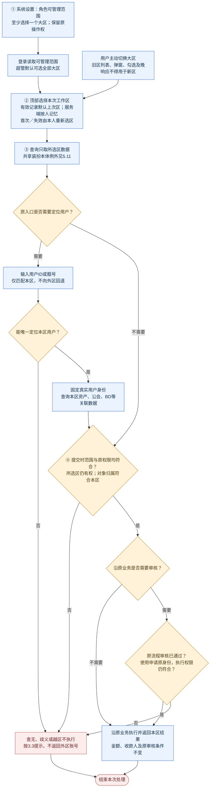

[查看核心后台范围流程图](./核对记录/流程图/flow-01.svg)

**超管的“全部大区”是可选范围，不是一次查询全部大区；角色授权不改变业务对象归属，顶部切区也不改变用户归属。** 切区为用户主动事件，不代表每次查询都自动切区；黄色为条件判断，红色为本次不执行的分支。首次无记忆或失权时重新选区，多角色合并及批量策略按3.3已确认规则执行；选择记忆不授予权限。

#### 靓号归属与本区定位的关系

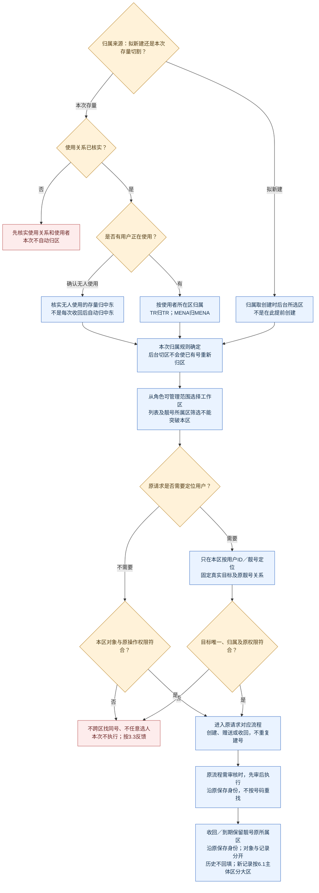

[查看靓号归属与定位流程图](./核对记录/流程图/flow-06.svg)

原业务需要审核时先审后执行，无审核时沿原直接操作，不新增审核机制。允许不同区使用相同靓号，创建和查询必须限定大区；不存在同区原始号与靓号重复占用、单个靓号对象被多人同时使用的情况。收回或到期保留靓号原所属区；原号被占用时不覆盖他人号码，先解决冲突再恢复。存量使用关系缺失时先核实，不能直接当作空闲号归中东。

## 4. 客户端功能模块

### 4.1 三方充值链接（靓号兼容版）

#### 模块背景

三方充值链接支持输入用户ID／靓号登录。输入的靓号匹配多个大区账号时，需要先确认本次使用的账号，再发送验证码；套餐和自定义充值比例继续沿用1.0按用户所属大区读取的规则。

#### 用户场景

用户输入靓号并点击“Send”，匹配多个大区账号后，在弹窗中选择自己的账号，点击“选择并发送验证码”，继续原有验证和充值流程。

#### 对应原型

对应当前Axure页面“三方充值链接（靓号兼容版）”，包含登录页、账号选择弹窗及按区展示充值配置的旁白。

#### 功能点：跨区同靓号账号选择与验证码登录

##### 功能说明

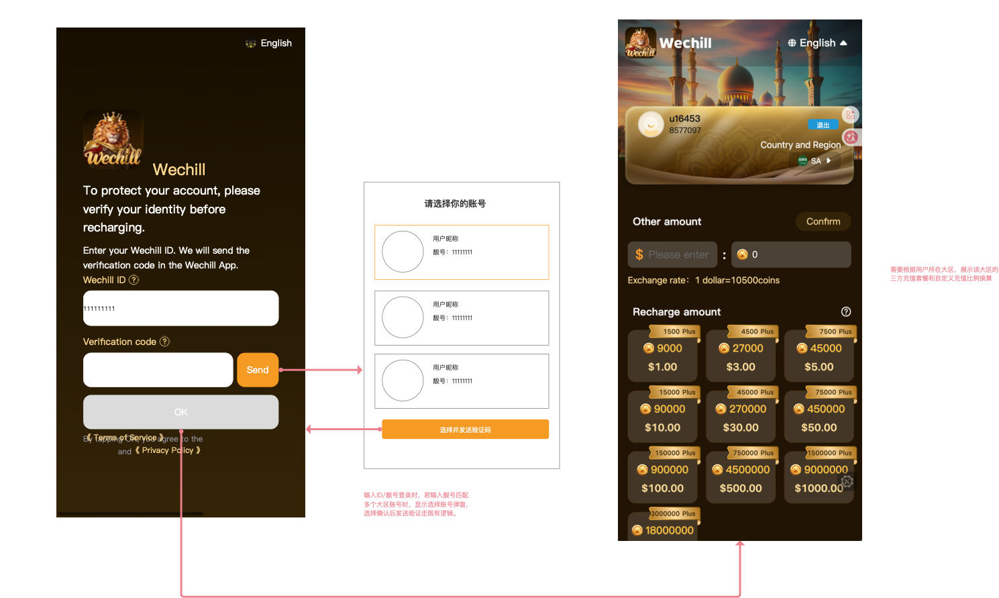

- **账号选择**：输入靓号匹配多个大区账号时，展示“请选择你的账号”弹窗；用户选择确认后，再向所选账号发送验证码并走既有验证逻辑。
- **充值配置承接**：验证通过后，以本次登录账号的真实所属大区展示三方充值套餐，并使用该区自定义充值比例换算金币；套餐、金额字段和换算规则沿用1.0的4.2，不另列示例价格。

##### 前置条件

用户已打开原三方充值链接登录页；本次兼容使用原账号资料、验证码发送及验证能力，不新增账号注册或用户切区流程。

##### 触发方式

在原“Wechill ID”输入框填写用户ID／靓号，点击“Send”；输入靓号且匹配多个大区账号时触发账号选择弹窗。

##### 字段与数据来源

仅列本次输入兼容及账号选择涉及的字段，原验证码输入、充值金额和套餐字段不重复列出。

| 字段 | 说明 | 统计方式 | 数据来源 |
| --- | --- | --- | --- |
| 用户ID／靓号输入 | 沿用原“Wechill ID”输入位置，支持按用户ID／靓号登录 | 本次输入 | 用户填写 |
| 候选账号头像 | 展示候选账号头像；原型以圆形位置示意 | 每个候选账号 | 候选账号资料 |
| 候选账号昵称 | 展示对应候选账号昵称 | 每个候选账号 | 候选账号资料 |
| 候选账号靓号 | 展示对应账号的靓号，允许本次候选中出现相同靓号 | 每个候选账号 | 本次号码匹配结果及账号资料 |
| 本次所选账号 | 确定本次发码、验证与登录对应的账号 | 本次选择 | 用户在候选列表中选择的账号 |

##### 交互逻辑

1. 用户输入用户ID／靓号并点击“Send”；未命中“靓号匹配多个大区账号”条件时，沿既有账号校验及发码流程。
2. 命中上述条件时，展示标题为“请选择你的账号”的弹窗，列出候选账号的头像、昵称和靓号，按大区、用户ID固定排序，不默认选中任何账号。用户未选择时，“选择并发送验证码”按钮不可用；候选较多时在原弹窗内滚动展示。
3. 取消或关闭弹窗时回到原输入步骤，不发送验证码；用户选择本次账号，点击“选择并发送验证码”后，向所选账号发送验证码，继续原登录页的验证码输入及“OK”验证流程。选择账号本身不代表验证通过。
4. 验证通过后，进入该登录账号对应的充值流程；套餐和自定义金额换算均读取该账号所属大区的配置，不取其他同号候选账号的大区。

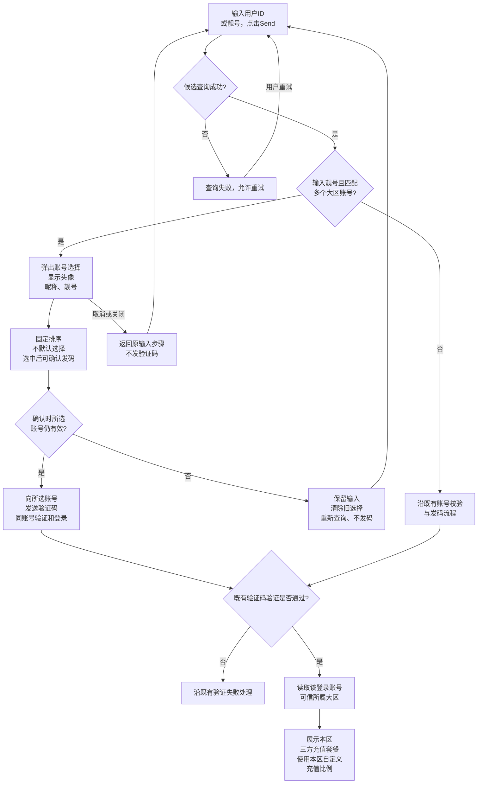

[查看三方充值靓号兼容流程静态图](./核对记录/流程图/flow-05.svg)

##### 服务端核心逻辑

- 多大区同靓号匹配结果用于选择本次账号；确认后，发码、验证码校验及登录应对应同一真实账号，不能在后续步骤仅按靓号重新选取另一账号。
- 充值所用大区从验证通过的账号可信资料取得，继承3.2的归属口径。该入口不使用后台左上角“所选大区”筛掉其他大区候选，也不因选择账号而改变其所属大区。
- 原套餐查询、自定义金额换算及交易处理沿用1.0的4.2；本次不新增套餐配置、汇率或支付处理规则。

##### 状态设计

| 情形／状态 | 进入或判定依据 | 本次处理与后续 |
| --- | --- | --- |
| 沿用原登录流程 | 未命中靓号跨区多账号条件 | 原账号校验、发码和验证逻辑不变 |
| 待选择账号 | 输入靓号匹配多个大区账号 | 展示候选列表，等待用户选择确认 |
| 已确认账号 | 点击“选择并发送验证码” | 按所选账号发码并进入既有验证流程，不视为已登录 |
| 已通过验证 | 该账号通过原验证码验证 | 按该登录账号真实所属大区展示套餐和自定义充值换算 |

##### 边界条件

- 原型中的三条账号仅为展示示意，不定义候选数量上限；橙色描边表示选中样式，不据此认定默认选中第一条。候选按大区、用户ID固定排序，不默认选中；本次不增加大区、用户ID等候选展示字段，不另行处理同头像、同昵称、同靓号的展示区分。
- 弹窗用于选择已匹配账号，不是手动选择大区。后台不同区可使用相同靓号，但后台查询仍必须限定所选区；三方充值不使用后台选区过滤。用户ID与靓号不会被同一次输入同时命中，不新增双类型冲突分支。

##### 异常处理

原验证码校验及验证失败沿原流程。候选查询失败时显示查询失败并允许重试，不当作“没有账号”；用户确认时所选账号已失效，则保留原输入、重新查询候选并清除旧选择，不给失效账号发码，也不自动改投其他账号。

##### 权限控制

沿原三方充值登录校验；必须通过本次账号的既有验证码验证后，才承接该账号充值流程。仅选择候选账号不获得其他账号的登录或充值权限。

## 5. 后台功能模块

本章各模块统一遵循3.3，不逐页重复全局范围；以下保留模块特有规则、原型与必要边界。

本章新增的是查询、定位和操作的区域约束。原型中已有筛选、列表、弹窗、原因枚举、审批和金额算法不整页重写；没有标注新增的控件不当作新字段。

### 5.1 后台大区选择与选择记忆

#### 模块背景

系统设置的角色可管理大区范围决定顶部候选区；选择其中一个大区，才确定本次后台工作范围。角色配置见5.16，核心关系见3.6。

#### 用户场景

操作人登录后台，在角色获配的大区中查询和操作；下次打开时恢复本人仍有效的上次选择。

#### 对应原型

当前Axure“选择大区”，与“系统设置”联动；只描述旁白新增范围及记忆规则。

#### 功能点：在角色授权范围内选区并记忆

##### 功能说明

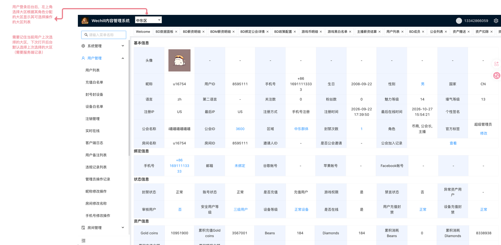

顶部可选列表按当前操作人的角色分配范围显示；超管默认可选全部大区。服务端记录本人上次选择，下次打开默认使用该记录；前提是该区仍在可管理范围内。选定某区后，全局查询、用户ID／靓号定位及操作均按3.3处理。

##### 前置条件

通过原后台登录；管理员已给已有角色分配可管理区。角色无可管理区时提示“当前账号未分配可管理大区，请联系管理员”；首次无记忆或记忆区已失权时由本人重新选区。未完成有效选择时不查询或操作业务数据。

##### 触发方式

登录／打开后台、切换顶部大区、再次打开后台。

##### 字段与数据来源

**顶部选择区**

| 字段 | 说明 | 统计方式 | 数据来源 |
| --- | --- | --- | --- |
| 大区候选列表 | 只列角色分配的可管理大区；超管为全局大区范围 | 本次登录／读取 | 5.16角色配置及全局大区枚举 |
| 本次所选大区 | 限定本次查询与操作；选择不能改变对象归属 | 本次选择 | 操作人的有效选择 |
| 本人上次所选区 | 下次打开默认恢复本人记录，不使用其他操作人的值 | 上次服务端保存记录 | 当前操作人的服务端选区记录 |

##### 交互逻辑

1. 登录后读取角色可管理范围；多角色取并集，超管可选全部大区。
2. 有仍可选的上次记录时默认该区；无记录或已失权时，让本人从现有顶部选择器重新选区。
3. 有未提交内容时先确认是否放弃，再切区；保存失败保留原工作区并提示失败。原区已失权时不能继续操作。
4. 保存成功后按新区重新查询，旧区列表、勾选、弹窗、详情及晚返回结果不能用于新区操作。
5. 各标签页、设备保留各自工作区；服务端只记最后一次成功保存的选区供下次打开使用，不强行切换其他页面。

##### 服务端核心逻辑

候选列表及查询、操作范围均需校验角色授权，不能只靠页面隐藏选项。角色范围限制与所选区过滤共同生效，原页面／按钮权限继续保留。上次记忆只是默认选择来源，不覆盖当前可管理范围。权限变更后，下一次查询、提交及审核都按最新权限核对；具体操作须由同一个有对应操作权且获配该区的角色授权，不能跨角色拼接。

##### 状态设计

| 情形／状态 | 判断依据 | 本次处理 |
| --- | --- | --- |
| 有有效上次选择 | 记忆区仍在本次可管理范围内 | 默认该区，进入本区工作 |
| 已切换 | 选中另一个有权限的大区 | 查询与操作切到新区，并按操作人记忆 |
| 无有效选择 | 首次无记录或上次区已失权 | 由本人重新选区，未选时提示“请选择操作大区” |
| 未获配可管理区 | 角色没有任何有效大区 | 联系管理员分配，不自动授权全区 |
| 选择保存失败 | 新选择未成功保存 | 提示失败并保留原工作区；原区失权时不能继续操作 |

##### 边界条件

超管可选全部大区不等于每次查全部区；切区不改变业务归属。多标签页不会相互强制切区，记忆以最后一次成功保存为准；放弃未提交内容必须先经本人确认。

##### 异常处理

加载失败不能回退为全区查询；选区保存失败保留原工作区并提示失败。未选区、无权限及目标不符分别按3.3固定提示处理；已失权工作区不能因保存失败而继续使用。

##### 权限控制

大区必须在角色可管理范围内，且仍具备原入口和操作权限；选区不产生原本没有的赠送、审批或删除权。

### 5.2 公会管理分区

#### 模块背景

当前公会页旁白明确仅查询、操作所选大区的用户公会数据。

#### 用户场景

操作人在所选区查询公会、按会长ID／靓号定位，并使用既有新增或管理操作。

#### 对应原型

下列画布保留原页面及新增旁白；本文仅描述分区变化，不将既有字段和示例数值列为新增需求。

#### 功能点：公会查询与操作范围限定

##### 功能说明

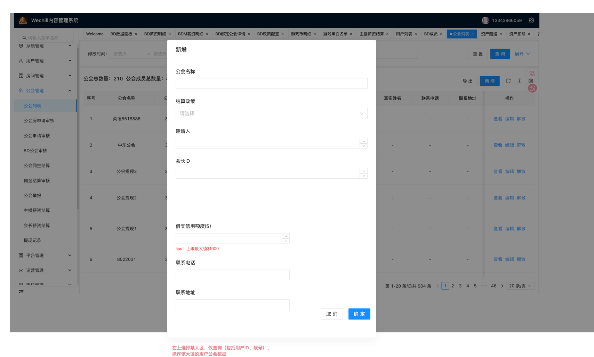

公会列表、原有筛选及操作按所选区执行。新增公会时，会长等用户定位在本区内完成；结算政策、邀请人等既有字段不重述其原规则。

##### 前置条件

已选择大区并拥有原公会管理操作权；目前公会、会长、主播与BD／BDM不存在不同区的情况；邀请人与政策不同区是否允许操作仍见T05。

##### 触发方式

查询公会、输入关联用户号码、提交既有公会操作。

##### 字段与数据来源

仅列本次改变范围的既有字段／区块；不表示新增同名控件或列表列。

**新增表单**

| 字段 | 说明 | 统计方式 | 数据来源 |
| --- | --- | --- | --- |
| 会长ID | 按旁白在所选区定位会长用户，支持原入口的号码语义 | 本次新增与提交 | 可信用户资料 |

##### 交互逻辑

- **查询**：按原条件取本区公会，无结果沿原空态。
- **提交**：再次核对公会和目标用户归属；不合范围的目标不能被创建／修改。
- **结果**：返回本区原业务处理结果，不自动调整公会区。

##### 服务端核心逻辑

公会、会长及相关政策保留原关系，不因选区迁移或换绑。目前会长、公会、主播、BD／BDM均为同区，不新增跨区组织规则；邀请人与政策不同区的资格仍待T05确认。

##### 状态设计

| 情形／原状态 | 进入或判定依据 | 本次处理与后续 |
| --- | --- | --- |
| 本区公会／用户 | 归属与所选区一致 | 按原资格和流程处理 |
| 区外用户或关联不明确 | 无法满足本次范围或存在多主体关系缺口 | 不作用于区外目标；跨主体规则见T05 |

##### 边界条件

会长、邀请人、公会、政策不能仅因同处一张表单而视为同区；借支额度上限不是本轮新增。

##### 异常处理

本区无匹配、归属变化或政策关联冲突不能静默转到其他区；反馈见T19，跨主体规则见T05。

##### 权限控制

沿原公会管理和申请审核权限，不因选区增加操作权。

### 5.3 资产赠送分区

#### 模块背景

最新旁白同时覆盖单笔赠送和批量赠送，不能仅隔离列表。

#### 用户场景

操作人查看本区赠送记录，向本区用户提交单笔或批量资产赠送。

#### 对应原型

下列画布保留原页面及新增旁白；本文仅描述分区变化，不将既有字段和示例数值列为新增需求。

#### 功能点：单笔及批量赠送的查询、定位与提交

##### 功能说明

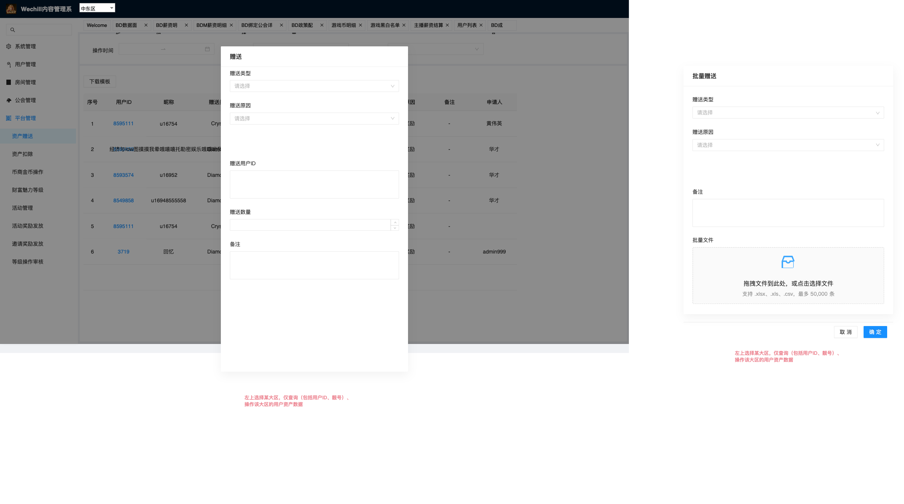

本区记录、本区用户ID／靓号定位、本区赠送执行统一限定范围。金币、钻石、水晶等原资产类型及赠送原因沿现状，水晶功能不变不豁免本节后台范围校验。

##### 前置条件

有原资产赠送权限；单笔或批量目标可按所选区确定身份。

##### 触发方式

原列表查询、赠送弹窗确定、批量文件提交。

##### 字段与数据来源

仅列本次改变范围的既有字段／区块；不表示新增同名控件或列表列。

**筛选区**

| 字段 | 说明 | 统计方式 | 数据来源 |
| --- | --- | --- | --- |
| 用户ID | 所选区内定位记录对应用户；原入口的靓号兼容受同一区约束 | 本次查询 | 可信用户资料及原记录 |

**单笔／批量赠送表单**

| 字段 | 说明 | 统计方式 | 数据来源 |
| --- | --- | --- | --- |
| 赠送用户ID | 所选区内确定接收方，不新增独立靓号输入框 | 本次单笔提交 | 可信用户资料 |
| 批量文件 | 先整批检查目标，发现问题整批不执行并列出问题项；通过后逐条展示结果 | 本次批量提交 | 原格式批量文件及可信用户资料 |

##### 交互逻辑

- **单笔**：输入目标后在本区定位，提交时再次核验，沿原审批／执行结果返回。
- **批量**：先核验整批目标；包含区外、无匹配、无法唯一识别或重复目标时，整批不执行并列出问题项。检查通过后逐条执行、显示成功或失败；重试只处理失败项，成功项不重复赠送。
- **结果**：提交与到账分别按原流程展示，不增设新审批级别。

##### 服务端核心逻辑

单笔、批量及审核后执行均使用已确定的不可变用户身份；不得通过文件或审核二次按号解析绕过分区。借支／预支涉及接收方与扣薪方时分别核对，跨区关系见T05。

##### 状态设计

| 情形／原状态 | 进入或判定依据 | 本次处理与后续 |
| --- | --- | --- |
| 目标明确且在本区 | 本次定位及提交校验一致 | 进入原赠送／审核流程 |
| 批量混区或无唯一匹配 | 至少一目标不满足范围 | 整批不执行，列出问题项；修正后重新检查 |
| 原申请待审／执行中 | 已保存申请但尚未最终完成 | 沿原状态，不把重新查询当再次赠送 |

##### 边界条件

整批检查不通过与执行中部分失败分开：前者整批不执行，后者保留已成功结果，只重试失败项。原赠送数量、借支／预支金额算法不变。

##### 异常处理

重复提交和执行结果不明确沿原业务结果核对，不能因页面重试再赠一遍；新分区失败反馈见T19，旧待审见T14。

##### 权限控制

继承原赠送与审批权限，批量不获得额外跨区能力。

### 5.4 资产扣除分区

#### 模块背景

扣除页新增旁白要求查询与操作均限定于所选区用户资产。

#### 用户场景

操作人在本区查扣除记录并按用户ID／靓号提交原有扣除。

#### 对应原型

下列画布保留原页面及新增旁白；本文仅描述分区变化，不将既有字段和示例数值列为新增需求。

#### 功能点：扣除目标与记录隔离

##### 功能说明

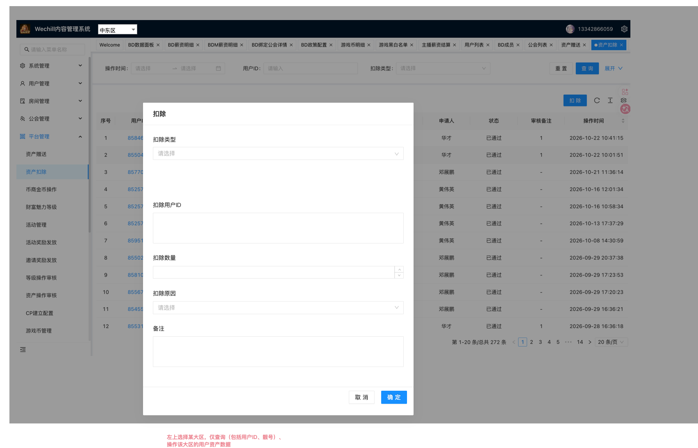

扣除记录、扣除用户定位和实际扣除统一使用所选区范围。既有扣除类型、数量、原因和余额处理规则保留。

##### 前置条件

拥有原扣除权限；目标在所选区内可唯一确定。

##### 触发方式

查询、打开扣除弹窗、点击确定。

##### 字段与数据来源

仅列本次改变范围的既有字段／区块；不表示新增同名控件或列表列。

**扣除表单**

| 字段 | 说明 | 统计方式 | 数据来源 |
| --- | --- | --- | --- |
| 扣除用户ID | 在所选区定位实际被扣方 | 本次提交 | 可信用户资料 |

##### 交互逻辑

查询只返回本区；提交核验目标范围后进入原扣除流程。切区后旧目标不能直接在新区提交。

##### 服务端核心逻辑

实际被扣方使用原申请固定身份；原有审核、余额不足处理与资产种类不改。不同区同展示号不能造成扣错人。

##### 状态设计

| 情形／原状态 | 进入或判定依据 | 本次处理与后续 |
| --- | --- | --- |
| 本区有效目标 | 符合范围及原扣除条件 | 沿原流程执行 |
| 目标区不符 | 目标不在本次所选区 | 不执行对该目标的扣除 |
| 原扣除结果待核对 | 请求结果不明确 | 沿原记录核对，不直接重复扣除 |

##### 边界条件

本节只改范围，不增加活动流水扣回或新的负资产规则。

##### 异常处理

无匹配、区不符提示见T19；历史待审缺归属的处理见T14。

##### 权限控制

沿用原扣除／审核权限，不新增人工跨区调账能力。

### 5.5 币商金币操作分区

#### 模块背景

此页是平台对币商金币的既有操作，不等于币商身份管理，也不等于充值入口。

#### 用户场景

操作人查询本区币商金币操作记录，提交原创建弹窗。

#### 对应原型

下列画布保留原页面及新增旁白；本文仅描述分区变化，不将既有字段和示例数值列为新增需求。

#### 功能点：币商资产操作范围限定

##### 功能说明

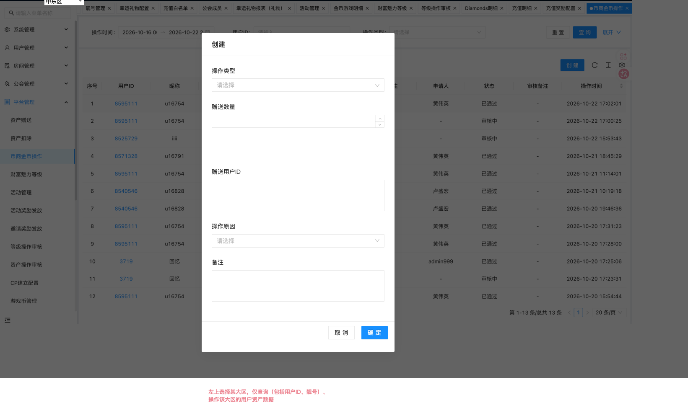

用户资产查询与操作按所选区限制；操作类型、赠送数量、原因等保持原业务定义。

##### 前置条件

有币商金币操作权限，目标属于所选区。

##### 触发方式

查询本区记录、创建并提交原操作。

##### 字段与数据来源

仅列本次改变范围的既有字段／区块；不表示新增同名控件或列表列。

**创建表单**

| 字段 | 说明 | 统计方式 | 数据来源 |
| --- | --- | --- | --- |
| 赠送用户ID | 在所选区定位原币商金币操作目标 | 本次提交 | 可信用户与币商资料 |

##### 交互逻辑

按本区定位目标并提交；存在审核的继续原流程。新增、创建成功不等于审核已通过。

##### 服务端核心逻辑

执行及后续审核沿原申请目标身份与业务范围；本节不改币商买卖价格、水晶功能或充值套餐。

##### 状态设计

| 情形／原状态 | 进入或判定依据 | 本次处理与后续 |
| --- | --- | --- |
| 本区目标 | 目标及原资格合法 | 进入原操作流程 |
| 区外目标 | 不属于所选区 | 不能操作其金币 |
| 原待审／完成状态 | 由原业务结果确定 | 查询限制本区，原状态推进不改 |

##### 边界条件

与5.8币商新增／关联公会分开；不能用本页操作范围推导币商可跨区售币。

##### 异常处理

本区找不到用户或审核时归属不可靠见T19、T14；不改为全区搜索继续执行。

##### 权限控制

沿原创建、审核权限执行，不新增直接免审赠送。

### 5.6 后台财富魅力操作分区

#### 模块背景

1.0覆盖的是等级及获取配置；当前后台人工操作页的查询和操作范围仍需分区。

#### 用户场景

操作人查询本区等级操作记录，并向本区目标提交原有财富／魅力操作。

#### 对应原型

下列画布保留原页面及新增旁白；本文仅描述分区变化，不将既有字段和示例数值列为新增需求。

#### 功能点：人工操作目标与记录归区

##### 功能说明

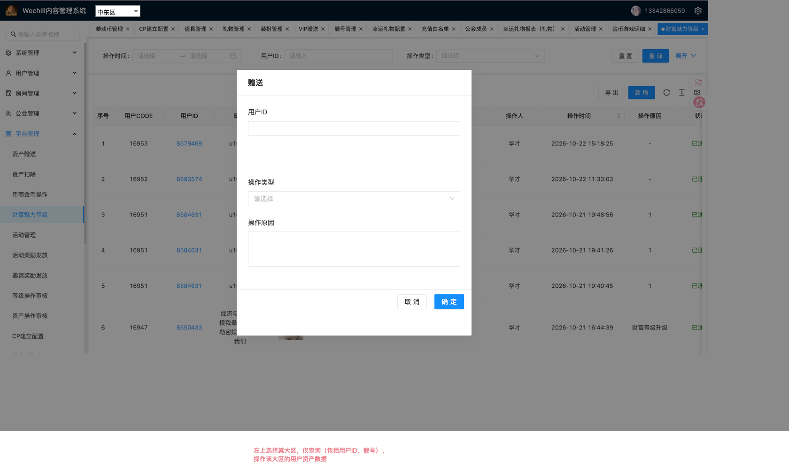

仅查询和操作所选区用户的财富／魅力相关数据；原操作类型、原因及审核规则沿现状。该后台改造不重写1.0等级阈值或送收礼获取配置。

##### 前置条件

已选区，具备原等级操作权，目标可在本区确定。

##### 触发方式

原列表查询和赠送／操作弹窗确定。

##### 字段与数据来源

仅列本次改变范围的既有字段／区块；不表示新增同名控件或列表列。

**操作表单**

| 字段 | 说明 | 统计方式 | 数据来源 |
| --- | --- | --- | --- |
| 用户ID | 在所选区定位财富／魅力操作对象 | 本次提交 | 可信用户资料 |

##### 交互逻辑

在本区确定目标与原操作类型；提交后继续原审批或执行链路，并查看本区结果。

##### 服务端核心逻辑

人工操作必须固定目标身份与分区，最终等级结果承接1.0本人所属区配置；具体赠送／调整语义仍按原类型，不臆造新值或算法。

##### 状态设计

| 情形／原状态 | 进入或判定依据 | 本次处理与后续 |
| --- | --- | --- |
| 本区可操作 | 目标满足范围及原资格 | 沿原等级操作流程 |
| 区不符 | 目标属于其他区 | 不作用于该用户等级数据 |
| 待审／已处理 | 原流程已有状态 | 保留状态与结果，不重新发起同一操作 |

##### 边界条件

财富与魅力是不同操作对象；本节不将等级变更等同于账户金币赠送。

##### 异常处理

分区匹配失败反馈见T19，原等级操作失败沿现状，不假定已生效。

##### 权限控制

继承原等级操作及审核权，不与普通资产赠送权限自动合并。

### 5.7 后台游戏币管理分区

#### 模块背景

本节是后台游戏币赠送／操作的区域隔离，钱包兑换游戏币已由1.0覆盖。

#### 用户场景

操作人查看本区游戏币记录，通过原创建弹窗处理本区用户。

#### 对应原型

下列画布保留原页面及新增旁白；本文仅描述分区变化，不将既有字段和示例数值列为新增需求。

#### 功能点：游戏币后台操作范围限定

##### 功能说明

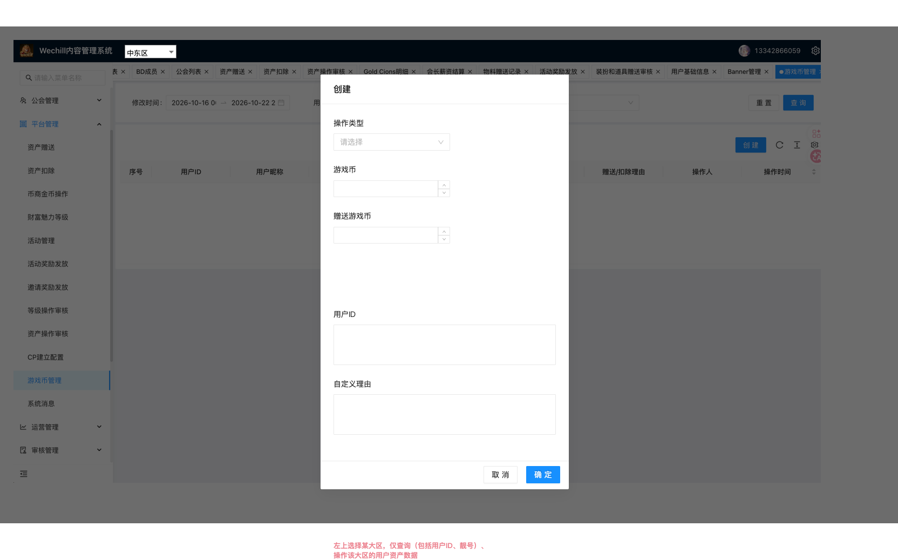

游戏币查询、用户ID／靓号定位和赠送操作仅作用于所选大区。原游戏币数量、操作类型和理由规则不变。

##### 前置条件

有原游戏币管理权限，目标属于所选区。

##### 触发方式

查询、创建、原弹窗提交。

##### 字段与数据来源

仅列本次改变范围的既有字段／区块；不表示新增同名控件或列表列。

**赠送游戏币表单**

| 字段 | 说明 | 统计方式 | 数据来源 |
| --- | --- | --- | --- |
| 用户ID | 在所选区定位游戏币操作对象 | 本次提交 | 可信用户资料 |

##### 交互逻辑

本区查人，核验后提交；操作结果继续原链路，返回本区记录。切换区后旧用户不能误用于新操作。

##### 服务端核心逻辑

固定目标身份并核验区域；后台加币不改为钱包金币扣除，也不重新定义1.0兑换比例。

##### 状态设计

| 情形／原状态 | 进入或判定依据 | 本次处理与后续 |
| --- | --- | --- |
| 本区目标 | 匹配范围及原资格 | 进入原游戏币操作流程 |
| 非本区目标 | 归属不符 | 不操作该用户游戏币 |
| 原处理结果 | 原业务执行／审核返回 | 按原结果查询，不能把网络返回失败视作从未处理 |

##### 边界条件

后台加减、钱包兑换、游戏下注／派奖是不同入口，不串用流程。

##### 异常处理

无匹配及区不符见T19；执行失败继续原机制，旧在途归属见T14。

##### 权限控制

保留游戏币原操作权；不新增游戏供应商结算或跨区派奖能力。

### 5.8 币商管理分区

#### 模块背景

新增旁白要求币商数据按所选区查询与操作，需与平台币商金币操作区分。

#### 用户场景

操作人查看本区币商、新增币商并使用已有公会关联选择。

#### 对应原型

下列画布保留原页面及新增旁白；本文仅描述分区变化，不将既有字段和示例数值列为新增需求。

#### 功能点：币商身份与关联目标范围限定

##### 功能说明

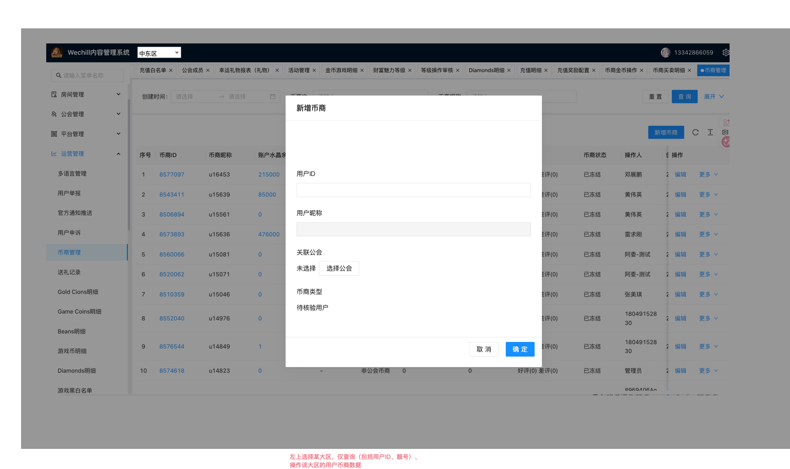

币商列表、目标用户ID／靓号定位按所选区；新增或管理动作仅处理该区币商。原币商类型、资格审核及关联业务不重新设计。

##### 前置条件

拥有原币商管理操作权，用户在本区可确定；关联公会跨区资格见T05。

##### 触发方式

列表查询、新增币商、原关联公会选择与提交。

##### 字段与数据来源

仅列本次改变范围的既有字段／区块；不表示新增同名控件或列表列。

**新增币商表单**

| 字段 | 说明 | 统计方式 | 数据来源 |
| --- | --- | --- | --- |
| 用户ID | 在所选区定位币商目标；关联公会跨区资格另见T05 | 本次提交 | 可信用户及原币商资料 |

##### 交互逻辑

先在本区确定用户，再按原表单处理昵称、类型和公会关联；跨主体未定的关联不写成默认允许或禁止。

##### 服务端核心逻辑

用户、币商、公会分别核对；不能仅因为选择了本区，就把外区公会自动迁入本区或替换原关联。

##### 状态设计

| 情形／原状态 | 进入或判定依据 | 本次处理与后续 |
| --- | --- | --- |
| 本区用户／币商 | 归属匹配 | 按原身份管理规则处理 |
| 关联主体不同区 | 币商与公会等主体不同区 | 资格与操作结果见T05 |
| 原资格待核验 | 现有币商流程中的状态 | 原判定条件不改 |

##### 边界条件

不把选区当成币商跨区卖币授权，也不调整币商价格体系。

##### 异常处理

用户查无结果反馈见T19；公会关联变化／丢失沿原业务并结合T05确认，不自动替换关系。

##### 权限控制

沿原币商管理资格；资产赠扣仍由其原操作权限负责。

### 5.9 游戏黑白名单分区

#### 模块背景

最新旁白限定所选区游戏名单数据；原弹窗同时存在黑名单、白名单业务。

#### 用户场景

操作人按本区用户ID／靓号查询并新增既有类型的游戏名单。

#### 对应原型

下列画布保留原页面及新增旁白；本文仅描述分区变化，不将既有字段和示例数值列为新增需求。

#### 功能点：名单目标与查询范围隔离

##### 功能说明

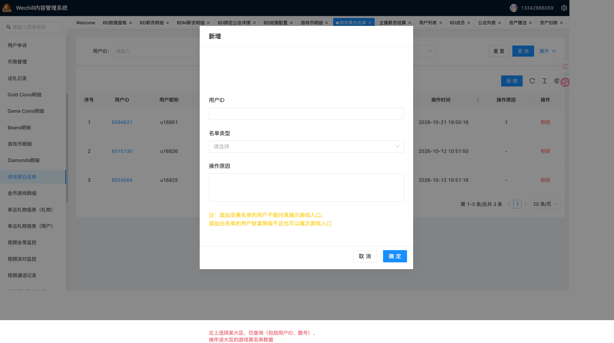

列表和新增目标限定本区。黑名单不展示游戏入口、白名单可在财富等级不足时展示入口的原语义保留；不新增另一套游戏等级门槛。 重复添加沿用用户既有第三方游戏名单确认口径，不是本次Axure新增：用户已在黑名单或白名单任一名单中时，不能继续添加至任何名单；提示“该用户已在名单中，无法继续添加至名单”。

##### 前置条件

拥有原名单管理权，目标在所选区；用户已经在黑名单或白名单任一名单中时，不能继续添加至任何名单。

##### 触发方式

原名单查询、新增弹窗确定及既有名单操作。

##### 字段与数据来源

仅列本次改变范围的既有字段／区块；不表示新增同名控件或列表列。

**新增名单表单**

| 字段 | 说明 | 统计方式 | 数据来源 |
| --- | --- | --- | --- |
| 用户ID | 在所选区定位目标；已有黑白名单互斥添加规则不变 | 本次提交 | 可信用户及原名单记录 |

##### 交互逻辑

- **定位**：在所选区确定用户。
- **提交**：核验已有名单，命中任一名单提示“该用户已在名单中，无法继续添加至名单”。
- **结果**：沿原名单添加结果刷新本区数据；不利用另一个区重复添加同一真实用户。

##### 服务端核心逻辑

名单跟随真实目标用户，不按输入号码新增另一份身份；既有重复添加限制不因后台切区而豁免。历史名单不补区、不直接作废；继续沿原有效性和黑白互斥规则检查。旧记录缺可信用户关联时先核实，不能据此绕过重复添加限制或扩大名单原影响范围。

##### 状态设计

| 情形／原状态 | 进入或判定依据 | 本次处理与后续 |
| --- | --- | --- |
| 未在任一名单 | 目标在本区且无有效已存名单 | 按原流程添加所选类型 |
| 已在黑／白任一名单 | 存在有效名单 | 不能继续添加至任何名单，使用固定提示 |
| 区不符 | 目标不在所选区 | 不添加该目标 |

##### 边界条件

不同区同展示号不能误判为同一用户；同一真实用户不能借后台切区绕过已有名单判断。

##### 异常处理

查无用户、区域不符见T19；原名单更换／解除及添加并发处理沿原业务，不在本轮新增流程。

##### 权限控制

沿用原名单操作权，新增白名单不等于绕过其他游戏准入或封禁规则。

### 5.10 靓号创建、发放与收回分区

#### 模块背景

新靓号按后台创建时所选大区归属；存量靓号按6.1处理。角色可管理区、后台所选区、靓号所属区与目标用户区的关系见3.2及3.6。

#### 用户场景

操作人在本区创建靓号、查询靓号及奖励用户，并执行原赠送、收回操作。

#### 对应原型

下列画布保留原页面及新增旁白；本文仅描述分区变化，不将既有字段和示例数值列为新增需求。

#### 功能点：靓号对象归区与用户操作限定

##### 功能说明

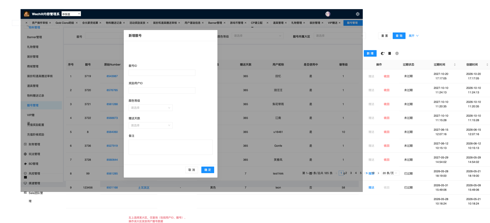

新靓号按创建时后台所选区归属；列表的“靓号所属大区”展示对象归属，同名筛选不得突破全局所选区。赠送、收回只处理本区对象与用户。原新增弹窗未画独立大区字段，不额外发明一个必填下拉框。

##### 前置条件

后台已选区并有原靓号操作权；不同区允许使用相同靓号，但创建与查询限定本区；不存在同区原始号与靓号重复占用的情况。

##### 触发方式

新增靓号、列表查询、赠送、收回及既有到期处理。

##### 字段与数据来源

仅列本次范围变化涉及的原字段，不重写颜色、天数和备注等原规则。

**筛选区／列表**

| 字段 | 说明 | 统计方式 | 数据来源 |
| --- | --- | --- | --- |
| 靓号所属大区 | 当前Axure文本包含同名列和筛选；两者不得突破全局所选区 | 本次查询 | 靓号对象归属 |

**新增／发放表单**

| 字段 | 说明 | 统计方式 | 数据来源 |
| --- | --- | --- | --- |
| 靓号ID | 新号归创建时后台所选区；不同区可同号，创建和查询必须限定大区 | 本次创建／发放 | 本次输入及原靓号对象 |
| 奖励用户ID | 在所选区定位接收方；后续执行固定用户身份 | 本次提交 | 可信用户资料及原发放关系 |

##### 交互逻辑

- **创建**：在所选区创建新靓号，原颜色、天数、备注等字段不改。
- **查询与发放**：只查本区对象及用户；筛选区外值不能展示区外数据。
- **收回／到期**：按原发放关系定位原用户，不按当前号码重新寻找接收方；解除使用关系后保留靓号原所属区。恢复原号遇占用时，不覆盖他人号码，先解决冲突再恢复。

##### 服务端核心逻辑

新号按创建区归属；存量归区统一按6.1的使用状态处理。原发放关系继续沿用。各区同号是不同靓号对象，单个靓号对象不存在多人同时使用的情况。只有核实确实无人使用的存量才归中东；使用关系缺失时先核实，不直接按空闲号处理。

##### 状态设计

| 情形／原状态 | 进入或判定依据 | 本次处理与后续 |
| --- | --- | --- |
| 新建靓号 | 在选定区创建成功 | 固定本次对象归属 |
| 存量使用中 | 已核实正在使用的用户 | 自动归使用者所在大区，见6.1；原有效期不变 |
| 存量无人使用 | 已核实确实无人使用 | 默认归中东地区，见6.1 |
| 存量归属待核实 | 使用关系缺失或尚未核实 | 先核实，不自动归区；沿原业务状态，不新增状态枚举 |
| 赠送／收回／到期处理 | 按原操作或有效期触发 | 只处理原身份与对应区对象；保留靓号原所属区，原状态枚举不改 |

##### 边界条件

靓号对象归区与发放记录分开：历史发放记录不回填，本版将分区后的发放记录按目标用户区分；切区不迁移已创建的号。

##### 异常处理

本区查无号码按3.3提示，不跨区找同号替代。存量使用关系缺失时先核实；原号恢复遇到占用时先解决冲突，不覆盖他人号码，也不误操作另一用户。

##### 权限控制

沿原创建、赠送、收回权限；不新增跨区迁号或全区号池管理权限。

### 5.11 装扮申请发放分区

#### 模块背景

旁白明确“仅申请发放物料时区分大区，物料本身不区分大区”。

#### 用户场景

操作人从共享装扮物料发起给本区用户的原赠送申请，并查询本区发放数据。

#### 对应原型

下列画布保留原页面及新增旁白；本文仅描述分区变化，不将既有字段和示例数值列为新增需求。

#### 功能点：共享物料与按区发放分离

##### 功能说明

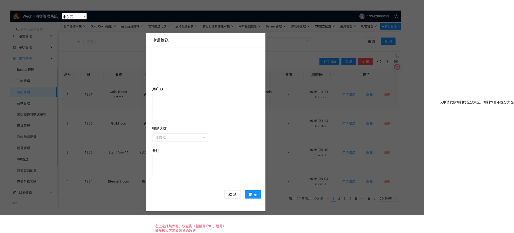

装扮物料本体保持共享，不复制为各区独立装扮；发放用户定位、申请与对应发放数据按所选区隔离。

##### 前置条件

有原装扮申请／发放权限，目标用户属于本区。

##### 触发方式

原物料申请赠送弹窗确定及原发放记录查询。

##### 字段与数据来源

仅列本次改变范围的既有字段／区块；不表示新增同名控件或列表列。

**申请赠送表单**

| 字段 | 说明 | 统计方式 | 数据来源 |
| --- | --- | --- | --- |
| 用户ID | 在所选区定位接收方；物料本体保持共享 | 本次申请与后续执行 | 可信用户资料 |

##### 交互逻辑

选择原装扮，输入本区目标，按原天数和备注提交申请；有审核的沿原审核。切区后不能用旧目标在新区继续申请。

##### 服务端核心逻辑

物料本体保持共享；历史申请记录不回填，分区后新申请在业务发起时记录目标用户的可信大区；审批、发放及回收使用原申请目标与物料关系。

##### 状态设计

| 情形／原状态 | 进入或判定依据 | 本次处理与后续 |
| --- | --- | --- |
| 共享物料可选 | 原物料状态允许申请 | 沿原物料规则，不加大区本体过滤 |
| 目标在本区 | 接收方归属匹配 | 进入原申请流程 |
| 原申请待审／已发放 | 现有业务状态 | 本区查结果，审核与回收按原申请身份 |

##### 边界条件

商品、物料与发放记录不是同一个对象；商城的分区商品要求不反向改变共享装扮。

##### 异常处理

无本区目标的反馈见T19；旧在途保留原用户、金额、价格和适用政策；缺身份先由有原权限人员核实，历史不回填、不开放全区查询。

##### 权限控制

保留原申请、审核及回收权限，不因物料共享自动放开全区发放。

### 5.12 商城后台分区

#### 模块背景

当前Axure明确商城按所选区查询和操作；最新脑图明确当前商城归中东、土区按新币价重新上架，各区分别管理商品ID。

#### 用户场景

操作人在本区查询和维护原商城数据，不重新设计商品编辑页。

#### 对应原型

下列画布保留原页面及新增旁白；本文仅描述分区变化，不将既有字段和示例数值列为新增需求。

#### 功能点：商城数据与商品归属范围

##### 功能说明

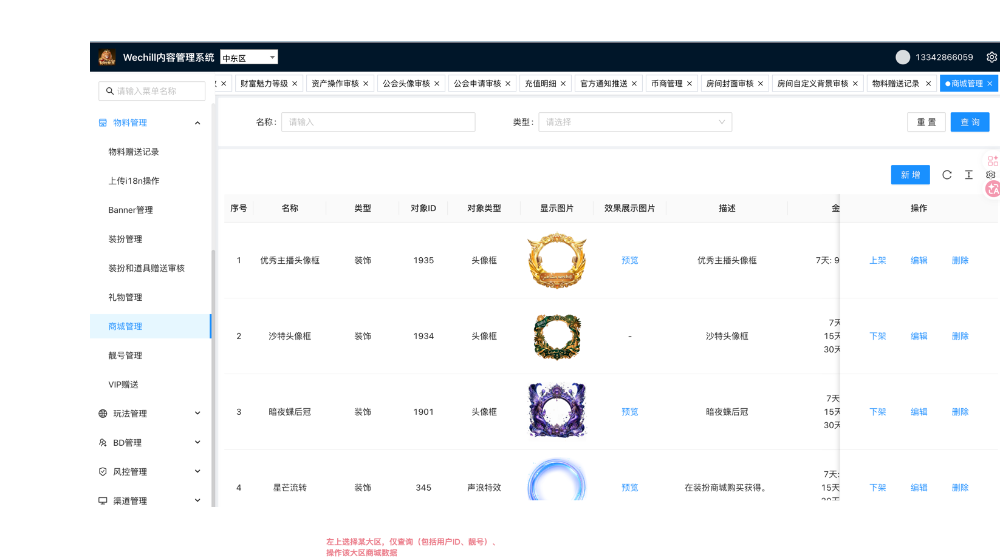

后台只查询、操作所选区商城数据，各区使用各自商品ID。存量当前商城默认归中东，土区按新币价重新上架；运营按已确认的新币价提供正式商品价格清单，并在业务负责人明确的切换窗口重新上架；已购权益及未完成旧订单保留原价格、原权益，不重复扣款，不增加未画出的新编辑表单。

##### 前置条件

已有商城管理权限，能够确定当前商品业务归属；土区正式商品清单、价格及上架窗口须先由负责人提供；其他区先核实原商品及归属，不直接套用中东或土区方案。

##### 触发方式

原商城查询及已有上／下架、编辑等操作。

##### 字段与数据来源

仅列本次改变范围的既有字段／区块；不表示新增同名控件或列表列。

**列表／原商品操作**

| 字段 | 说明 | 统计方式 | 数据来源 |
| --- | --- | --- | --- |
| 原有商城字段 | 只改变所选区查询和操作范围，不新增未画出的商品编辑字段 | 沿原页面口径 | 原商品及确认后的归属 |

##### 交互逻辑

本区查询后仅对本区商品执行既有操作。切区后不带入旧区商品继续编辑。

##### 服务端核心逻辑

商品与共享装扮本体分开管理，各区使用各自商品ID。现有商城商品归中东；土区按运营正式清单及新币价重新上架。用户已购权益、未完成旧订单保留原价格和原权益，不因重新上架改价、重复扣款或删除原购买关联。其他区先核实商品清单及原归属，再确定处理，不直接照搬。

##### 状态设计

| 情形／原状态 | 进入或判定依据 | 本次处理与后续 |
| --- | --- | --- |
| 归属明确的本区商品 | 可确定当前商品在本区 | 按原上／下架和编辑状态处理 |
| 现有商城／TR重新上架 | 最新脑图已明确 | 当前商城默认中东，TR按新价重新上架；正式清单和具体价格由运营提供，切换窗口由业务负责人明确 |
| 原上／下架状态 | 由原业务决定 | 不由后台切区自动改变 |

##### 边界条件

商品ID分区不改变共享装扮本体。不同天数／规格若另有独立SKU，其新建范围和新旧对应关系尚未在确认方案中明确，仍列6.4待补充，不把商品ID分区自行扩成全部规格SKU重建。

##### 异常处理

区外商品不能在本区修改。旧订单或商品关联资料不全时先核实，保留原购买关联、原价格和权益；未确认的商品映射不能通过删除旧订单或重复创建购买记录解决。

##### 权限控制

沿原商城操作权，原型有按钮不等于所有操作人均可使用。

### 5.13 财务数据与操作分区

#### 模块背景

最新旁白明确财务相关数据按所选区查询、操作；脑图要求财务审核、充值明细在月底结算前完成，游戏公司对账由财务牵头，按已确认的分区方式核对。

#### 用户场景

财务查看本区充值、币商买卖、提现与财审记录，并进行原有财务操作。

#### 对应原型

下列画布保留原页面及新增旁白；本文仅描述分区变化，不将既有字段和示例数值列为新增需求。

#### 功能点：财务业务范围与对账依赖

##### 功能说明

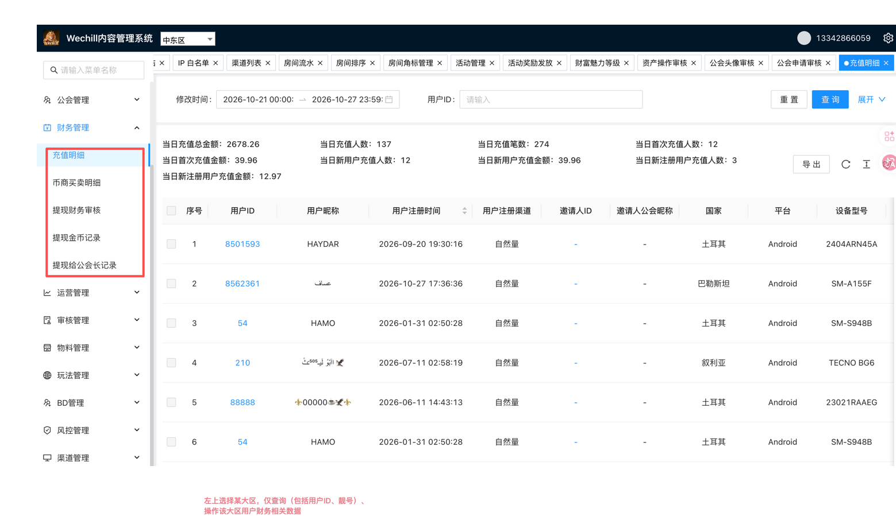

原型圈定充值明细、币商买卖明细、提现财务审核、提现金币记录、提现给公会长记录。本版将分区后记录按6.1对应主体区分，历史不做处理，原查询与财审操作沿用，不重述1.0充值、兑换功能。截图主体为充值明细，不冒称所有财务详情已画全。

##### 前置条件

有对应原财务权限；每笔记录的主体、归属、原金额可核对；旧记录及游戏账单缺口见T14、T16。

##### 触发方式

查询、展开详情、既有导出或财审动作，以及原月结／供应商对账。

##### 字段与数据来源

仅列本次改变范围的既有字段／区块；不表示新增同名控件或列表列。

**当前充值明细筛选区**

| 字段 | 说明 | 统计方式 | 数据来源 |
| --- | --- | --- | --- |
| 用户ID | 在所选区查询用户；旁白要求号码定位同区，不新增独立靓号框 | 本次查询，保留原时间筛选 | 可信用户及原资金记录 |

**当前统计区**

| 字段 | 说明 | 统计方式 | 数据来源 |
| --- | --- | --- | --- |
| 原有当日充值统计 | 金额、人数、笔数等分别限定本区；不重述或合并原指标 | 各指标原有当日口径，时间与时区沿现状 | 原统计结果限定本区；当日统计仍统计当天，修改明细时间筛选不改变统计区 |

##### 交互逻辑

- **查询／导出**：保持原入口和筛选，统计、明细及既有导出只限定同一所选区，各自原时间口径不变。
- **财审**：进入本区原申请，沿原审核流程；不按当前选区重新识别原收款人。
- **结算**：落实脑图“月底结算之前完成”的时间依赖，业务负责人提供具体结算账期和切换时刻，沿用现有财务时区；财务牵头按大区、原账期和对应APPID与游戏公司对账，使用原订单标识区分交易。

##### 服务端核心逻辑

分区后记录按6.1指定主体区分；历史不回填，原金额、收款人和审核执行对象不变。币商买卖明细按出售币商在业务发起时的可信大区归区，不按购买方或任意一方；不将同一交易按双方重复计入合计。未结束旧业务保留原用户、金额、价格和适用政策；缺可信身份先核实，未结工资按原政策处理。

##### 状态设计

| 情形／原状态 | 进入或判定依据 | 本次处理与后续 |
| --- | --- | --- |
| 分区后本区记录 | 按6.1主体归属匹配所选区 | 按原流程查询、审核及核对，原金额不变 |
| 旧在途记录 | 仍需支付／审核／退款／结算 | 保留原用户、金额、价格及适用政策；缺少可信身份先核实 |
| 纯归档历史 | 分区前历史记录 | 不回填、不重算；仅缺少可信身份／关联的旧记录承接见T14 |

##### 边界条件

查询“充值明细”不等于新增充值能力；当前余额、未结工资、已结算金额分开核对，不将金额和笔数混加。

##### 异常处理

缺少可信身份或归属的旧记录先由有原权限人员核实，不开放全区查询。对账差异列明原因后核对；重复记录不重复记账，延迟数据确认到账后再核对，不估算补账。原审核结果不明确时沿原单据核实，不直接重复执行，也不新增自动调账、冲销或补发。

##### 权限控制

继承各财务入口原权限；本次不建立新的财务角色矩阵或直接绕过原审批。

### 5.14 运营管理数据分区

#### 模块背景

最新运营页旁白要求仅查询、操作所选区用户运营管理相关数据，画布使用两个圈选侧栏说明范围。

#### 用户场景

操作人在原运营入口查看或处理本区用户数据及既有明细。

#### 对应原型

下列画布保留原页面及新增旁白；本文仅描述分区变化，不将既有字段和示例数值列为新增需求。

#### 功能点：运营业务查询与操作范围限定

##### 功能说明

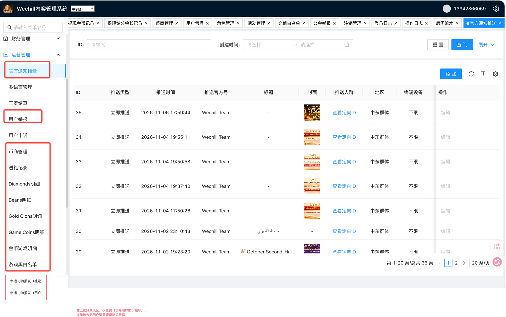

画布圈选涉及工资结算、用户举报、用户申诉、送礼记录、Diamonds／Beans／Gold Cions／Game Coins明细、金币游戏明细、幸运礼物报表（礼物／用户）等入口。主体仍是币商页，不能据截图补写各报表字段。用户业务记录按区；已确认共用的配置保持共用，多语言等其他配置的具体项目需逐项确认，见3.4及6.4。

##### 前置条件

有原对应运营操作权限；明确对象属于用户记录、业务记录还是共享配置。

##### 触发方式

进入原运营入口、按原条件查询及提交既有操作。

##### 字段与数据来源

仅列本次改变范围的既有字段／区块；不表示新增同名控件或列表列。

**菜单指向页面的范围变化**

| 字段 | 说明 | 统计方式 | 数据来源 |
| --- | --- | --- | --- |
| 原有用户定位与业务字段 | 按旁白限定本区；本图只圈菜单，未提供各子页新字段 | 各入口原有统计周期和筛选 | 各原运营入口的用户及业务记录 |

##### 交互逻辑

在原页面执行原筛选与操作，只限定本区用户记录；清空用户条件仍只返回本区，不恢复全区。既有详情和导出按3.3承接。

##### 服务端核心逻辑

运营用户数据与共享配置分开；游戏／幸运礼物历史不做处理，本版将分区后数据区分大区。用户存量资产无需处理，政策生效见T12。

##### 状态设计

| 情形／原状态 | 进入或判定依据 | 本次处理与后续 |
| --- | --- | --- |
| 本区用户记录 | 目标区明确且在范围内 | 按原页面操作 |
| 共享配置对象 | 不是单一用户区的数据 | 已确认共用的内容继续共用；其他项目先逐项确认，不任意按某个用户归区 |
| 历史统计缺归属 | 原记录无可靠归属 | 按T14、T17处理，不虚称已补齐 |

##### 边界条件

菜单出现不证明新详情、统计卡和新操作已设计；不将游戏明细与1.0游戏分区功能重复立项。

##### 异常处理

区域无法识别、报表历史口径不完整时不以全区值冒充本区值；具体反馈和旧记录承接见T14、T18、T19，不新增历史补区。

##### 权限控制

保留原入口和操作权限；用户及其关联业务数据均遵循全局规则，共享配置范围见T18。

### 5.15 内容审核分区

#### 模块背景

审核页被移入需要处理的后台目录；旁白沿用“用户运营管理相关数据”表述，但实际画布是内容审核。

#### 用户场景

审核人员在所选区查看用户／房间内容，并执行原通过、拒绝等审核。

#### 对应原型

下列画布保留原页面及新增旁白；本文仅描述分区变化，不将既有字段和示例数值列为新增需求。

#### 功能点：审核对象查询与结果操作隔离

##### 功能说明

画布圈定头像、昵称签名、背景照片、动态、房间封面、房间名称、房间欢迎语、房间自定义背景审核。本节描述内容审核页面；资产操作、等级操作及公会审核的新增独立原型另见本轮对应模块，均遵循3.3与6.1；不新增审核层级。

##### 前置条件

拥有原具体审核权限；分区后记录按对应用户区分，历史不回填。房间审核按房主的可信大区，用户内容审核按原对应用户；不能取后台操作人的大区。

##### 触发方式

查询审核对象、选中预览、执行既有单笔或一键通过。

##### 字段与数据来源

仅列本次改变范围的既有字段／区块；不表示新增同名控件或列表列。

**当前房间封面审核筛选区**

| 字段 | 说明 | 统计方式 | 数据来源 |
| --- | --- | --- | --- |
| 房主ID | 按房主的可信大区限定房间审核范围，在本区定位房主相关审核对象 | 本次查询与提交 | 可信用户资料及原审核记录 |

**原列表／预览区**

| 字段 | 说明 | 统计方式 | 数据来源 |
| --- | --- | --- | --- |
| 原审核对象与状态 | 只加载本区对象及其原内容，机审／人审状态含义不改 | 原修改时间范围及原状态 | 原审核记录 |

##### 交互逻辑

- **查询与预览**：只加载当前区审核对象及其内容。
- **提交**：通过、拒绝及一键操作都再次受本区约束。批量先整批检查；有混区、查无、身份不唯一或重复目标则整批不执行并列问题项，全部通过后逐条执行及展示结果，重试仅处理失败项；原审核资格和原因要求不变。
- **切区**：有未提交内容先确认是否放弃；成功切区后旧区预览与选中项不能作为新区审核目标。

##### 服务端核心逻辑

审核记录归区见6.1；通过或拒绝仍作用于原记录及已保存的不可变用户身份，不按当前号码重新找人。房间内容按房主可信大区确定范围；新记录取业务发起时对应主体的大区。旧资料缺身份先核实，不开放全区查询。

##### 状态设计

| 情形／原状态 | 进入或判定依据 | 本次处理与后续 |
| --- | --- | --- |
| 本区可审对象 | 范围匹配且原状态允许审核 | 进入原通过／拒绝流程 |
| 原审核状态已变 | 其他处理已发生或状态不允许 | 沿原状态校验，不重复覆盖结果 |
| 区外／归属未明 | 不符合范围或缺少可信归属 | 区外对象不执行；缺可信归属先核实，提示按3.3 |

##### 边界条件

当前截图中的按钮置灰仅代表画面状态，不定为新权限规则；机审通过不等于人工已完成。

##### 异常处理

切区时旧预览、归属不一致和旧待审反馈见T03、T14、T18、T19，不默认全量通过。

##### 权限控制

沿原内容审核权限；不新设自审豁免，不从按钮可见推定已授权。

### 5.16 系统设置：角色可管理大区范围

#### 模块背景

最新脑图要求“角色赋权可管理的大区”。系统设置原型在角色管理新增范围配置，联动后台顶部可选区；本轮明确纳入角色大区授权。

#### 用户场景

有原角色管理权限的操作人在原角色表单配置可管理大区；使用该角色的操作人登录后，仅能从获配范围中选择工作大区。

#### 对应原型

当前Axure“系统设置”，含角色筛选、列表及角色编辑表单。

#### 功能点：配置角色大区权限并联动选择范围

##### 功能说明

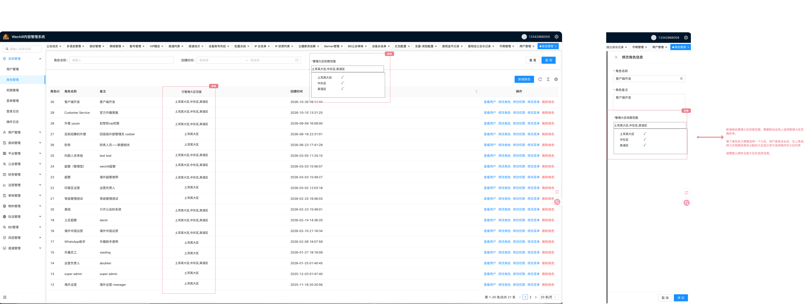

新增“管理大区权限范围”，联动全局选择管理大区的范围枚举；每个角色至少选择一个大区，可多选。角色列表新增“可管理大区范围”列。用户登录后，顶部候选区按其角色分配范围显示；超管默认拥有全部大区的选择范围。

##### 前置条件

沿用原角色管理与角色使用关系；修改角色需具备原角色管理权限，不新增角色类别或自我提权入口。

##### 触发方式

原角色查询、新增／编辑角色并保存；操作人后续登录读取其角色范围。

##### 字段与数据来源

**角色筛选区**

| 字段 | 说明 | 统计方式 | 数据来源 |
| --- | --- | --- | --- |
| 管理大区权限范围 | 按大区筛选时，角色可管理范围包含该区即符合；同时满足顶部所选区范围 | 本次查询 | 角色可管理范围及全局大区枚举 |

**角色列表**

| 字段 | 说明 | 统计方式 | 数据来源 |
| --- | --- | --- | --- |
| 可管理大区范围 | 展示该角色已配置的大区范围，不是当前顶部单个所选区 | 当前角色配置 | 已保存的角色范围 |

**新增／编辑角色表单**

| 字段 | 说明 | 统计方式 | 数据来源 |
| --- | --- | --- | --- |
| 管理大区权限范围 | 必填，多选，至少一个；候选与全局大区枚举联动 | 本次保存 | 管理人员选择及全局大区枚举 |

##### 交互逻辑

1. 打开原角色表单，展示其已配置的可管理大区；选择至少一个后按原保存流程提交。
2. 未选择任何大区不满足“至少一个”的条件，不能完成该角色范围保存；提示样式与文案见T19。
3. 列表展示已保存范围；操作人登录时以其角色范围生成5.1候选区。
4. 超管默认可选全部大区；其他角色不能因记住一个旧选择就获得当前未获配大区。

##### 服务端核心逻辑

角色范围候选取自统一大区枚举，至少一个大区的要求在保存时校验。角色范围约束顶部候选以及后续查询和操作，不只修改下拉显示。角色授权配置不等于按当前顶部所选区给用户或物料重新归区；已有角色先由管理员分配大区，不默认全部授权；多角色候选区取并集，但具体操作不能拼接不同角色的操作权限和大区。权限变更后，已登录账号下一次查询、提交、审核即按最新权限核对，失权旧结果不可继续操作。

##### 状态设计

| 情形／状态 | 依据 | 本次处理 |
| --- | --- | --- |
| 范围已配置 | 角色至少获配一个大区 | 列表展示范围，登录后联动顶部候选 |
| 本次清空全部选项 | 待保存集合为空 | 不符合保存条件，反馈见T19 |
| 超管 | 原超管身份 | 默认拥有全部大区的选择范围 |
| 旧角色缺配置／配置变更 | 新规则下原角色状态需承接 | 已有角色由管理员分配；变更后下次查询、提交、审核按最新权限核对 |

##### 边界条件

原型中的土耳其、中东、英语为枚举示意，不认定系统永久只有三个区；本次不改变原角色的页面及按钮权限。角色列表的局部筛选与顶部所选区共同限定展示范围；编辑角色仍沿原角色管理权限，不因顶部切区自动截断或改写该角色已有授权。

##### 异常处理

加载、保存失败沿原角色流程；新增大区范围校验反馈见T19。失败不能当作角色配置已生效。

##### 权限控制

只有具备原角色管理操作权的操作人可配置；可管理大区与原操作权共同生效，不因分配大区获得原本没有的业务权限。

### 5.17 BD成员

#### 模块背景

将当前指定页面接入共用分区边界；只描述分区变化或原型范围，不复述原业务全字段。

#### 用户场景

操作人在有权限的所选大区进入本页，按原业务范围查询或处理。

#### 对应原型

当前Axure指定目录“BD成员”；完整画布如下，缺少分区控件的现状截图仍按本文已确认共用要求处理。

#### 功能点：BD成员分区范围

##### 功能说明

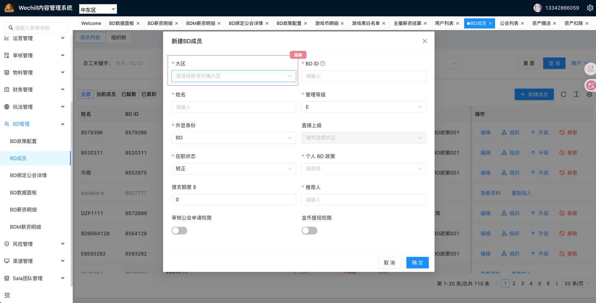

新建BD成员弹窗隐藏“大区”字段整组，红框不包括BD ID或直接上级。查询及原成员操作按3.3限定所选区。

##### 前置条件

具备原入口及操作权限，所选区在角色可管理范围内；首次无记忆或原区失权时从顶部选择器重新选区，不自动代选。后续查询、提交和审核均核对最新权限，失权区旧结果不能继续操作。

##### 触发方式

原新建成员、成员查询及已有操作。

##### 字段与数据来源

本页不新增其他业务字段，仅明确受分区影响的范围。

| 字段 | 说明 | 统计方式 | 数据来源 |
| --- | --- | --- | --- |
| 新建弹窗／大区字段 | 按原型隐藏，不让操作人通过弹窗另选区 | 本次表单 | 原新建BD成员表单 |

##### 交互逻辑

新BD归属取服务端可信用户资料；顶部所选区只核对该用户是否可在当前区创建BD身份，不能覆盖用户真实大区。归属无法确认时先不创建。“直接上级”只加载当前区符合原资格的上级，不再依赖已隐藏的大区字段，再按原创建流程提交。

##### 服务端核心逻辑

查询、定位及执行共同遵守3.3，不只过滤列表；不信任自报大区，不改原业务资格、金额及保存身份。非单用户／共享配置按本节明确范围处理，不强行套用某个用户的大区。

##### 状态设计

沿原业务状态，不新增状态流；本区／切区情形统一见3.3，模块特有边界见下文。菜单总览不补造独立业务状态。

##### 边界条件

目前不存在会长、公会、主播、BD／BDM不同区的情况；本次不据此新增跨区绑定资格或跨区禁令。本图仅新建弹窗，不能类推编辑弹窗或组织树也隐藏。

##### 异常处理

原业务失败沿原流程；分区异常使用3.3已确认的共用提示，不返回其他区账号信息。未定义的默认、补偿或重试不自行补造。

##### 权限控制

角色可管理范围、顶部所选区及原入口／操作权共同生效；切区不产生新权限，也不迁移原对象归属。

### 5.18 BD政策配置

#### 模块背景

将当前指定页面接入共用分区边界；只描述分区变化或原型范围，不复述原业务全字段。

#### 用户场景

操作人在有权限的所选大区进入本页，按原业务范围查询或处理。

#### 对应原型

当前Axure指定目录“BD政策配置”；完整画布如下，缺少分区控件的现状截图仍按本文已确认共用要求处理。

#### 功能点：BD政策配置分区范围

##### 功能说明

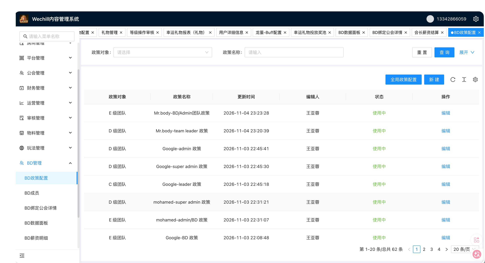

具体BD政策的查询、新建及修改接入所选区范围，不重写原薪资政策公式。存量政策先分配给对应区BD，分区时按当前有效绑定BD所在区归属；多区共用政策按各区当前有效BD分别分配。

##### 前置条件

具备原入口及操作权限，所选区在角色可管理范围内；首次无记忆或原区失权时从顶部选择器重新选区，不自动代选。后续查询、提交和审核均核对最新权限，失权区旧结果不能继续操作。

##### 触发方式

原政策查询、新建或修改。

##### 字段与数据来源

本页不新增其他业务字段，仅明确受分区影响的范围。

| 字段 | 说明 | 统计方式 | 数据来源 |
| --- | --- | --- | --- |
| 政策列表／归属范围 | 查询及操作限定所选区，存量按6.1处理 | 当前配置 | 政策与其绑定BD的业务关系 |

##### 交互逻辑

本区进入原具体政策流程；“全局政策配置”原入口保留，已确认的BD全局政策模板继续共享，与已归区的具体BD政策分开处理，不把共享模板改成区内政策，也不因该入口名称放开具体政策的全区操作。原继承／覆盖关系不变。

##### 服务端核心逻辑

查询、定位及执行共同遵守3.3，不只过滤列表；不信任自报大区，不改原业务资格、金额及保存身份。非单用户／共享配置按本节明确范围处理，不强行套用某个用户的大区。

##### 状态设计

沿原业务状态，不新增状态流；本区／切区情形统一见3.3，模块特有边界见下文。菜单总览不补造独立业务状态。

##### 边界条件

无绑定BD、绑定BD已离职，或换绑导致归属不清的政策先人工核实，不随便指定大区；归区完成后不因后续换绑自动迁移政策。未结工资沿原适用政策处理，已确定的生效口径见3.5及6.2，实际切换日期仍需负责人提供。

##### 异常处理

原业务失败沿原流程；分区异常使用3.3已确认的共用提示，不返回其他区账号信息。未定义的默认、补偿或重试不自行补造。

##### 权限控制

角色可管理范围、顶部所选区及原入口／操作权共同生效；切区不产生新权限，也不迁移原对象归属。

### 5.19 BD数据面板

#### 模块背景

将当前指定页面接入共用分区边界；只描述分区变化或原型范围，不复述原业务全字段。

#### 用户场景

操作人在有权限的所选大区进入本页，按原业务范围查询或处理。

#### 对应原型

当前Axure指定目录“BD数据面板”；完整画布如下，缺少分区控件的现状截图仍按本文已确认共用要求处理。

#### 功能点：BD数据面板分区范围

##### 功能说明

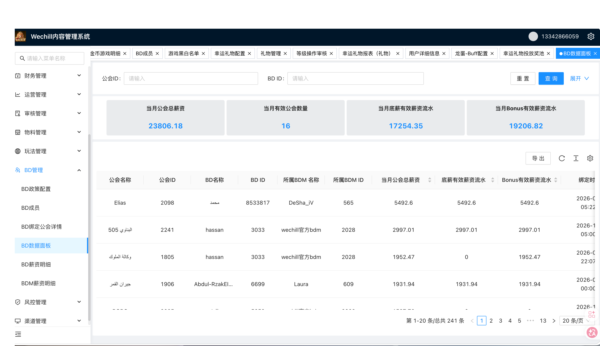

BD查询、已有统计卡片、明细及导出均限定所选区；不新增指标或改原统计周期。

##### 前置条件

具备原入口及操作权限，所选区在角色可管理范围内；首次无记忆或原区失权时从顶部选择器重新选区，不自动代选。后续查询、提交和审核均核对最新权限，失权区旧结果不能继续操作。

##### 触发方式

原筛选查询、下钻及导出。

##### 字段与数据来源

本页不新增其他业务字段，仅明确受分区影响的范围。

| 字段 | 说明 | 统计方式 | 数据来源 |
| --- | --- | --- | --- |
| 统计卡片／明细／导出范围 | 限定本区BD及允许查询的本区关联数据，不混入外区 | 沿原时间筛选及统计周期 | BD及其公会等原关联数据 |

##### 交互逻辑

本区定位BD后查询本区关联数据；统计、明细、导出使用同一大区约束，不据截图推定导出当前页还是全部筛选结果。

##### 服务端核心逻辑

查询、定位及执行共同遵守3.3，不只过滤列表；不信任自报大区，不改原业务资格、金额及保存身份。非单用户／共享配置按本节明确范围处理，不强行套用某个用户的大区。

##### 状态设计

沿原业务状态，不新增状态流；本区／切区情形统一见3.3，模块特有边界见下文。菜单总览不补造独立业务状态。

##### 边界条件

目前不存在会长、公会、主播、BD／BDM不同区的情况，本次不新增跨区关系或贡献分配规则。新增记录取业务发起时服务端确认的对应用户大区，不取操作人的大区；历史记录不补区，能关联可信用户的仍只查所选区，无法关联的由有原处理权限的人员核实，不开放全区查询。

##### 异常处理

原业务失败沿原流程；分区异常使用3.3已确认的共用提示，不返回其他区账号信息。未定义的默认、补偿或重试不自行补造。

##### 权限控制

角色可管理范围、顶部所选区及原入口／操作权共同生效；切区不产生新权限，也不迁移原对象归属。

### 5.20 BD薪资明细

#### 模块背景

将当前指定页面接入共用分区边界；只描述分区变化或原型范围，不复述原业务全字段。

#### 用户场景

操作人在有权限的所选大区进入本页，按原业务范围查询或处理。

#### 对应原型

当前Axure指定目录“BD薪资明细”；完整画布如下，缺少分区控件的现状截图仍按本文已确认共用要求处理。

#### 功能点：BD薪资明细分区范围

##### 功能说明

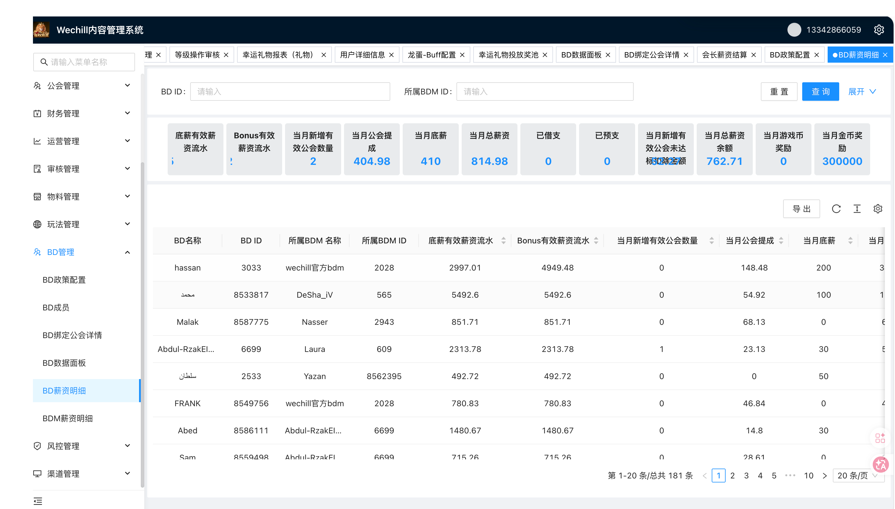

BD及所属BDM定位、薪资汇总、明细与导出均受所选区约束；不改变原薪资公式、币种或周期。

##### 前置条件

具备原入口及操作权限，所选区在角色可管理范围内；首次无记忆或原区失权时从顶部选择器重新选区，不自动代选。后续查询、提交和审核均核对最新权限，失权区旧结果不能继续操作。

##### 触发方式

原BD薪资查询及导出。

##### 字段与数据来源

本页不新增其他业务字段，仅明确受分区影响的范围。

| 字段 | 说明 | 统计方式 | 数据来源 |
| --- | --- | --- | --- |
| 薪资查询／汇总／明细 | 按所选区限定BD及本区关联数据 | 沿原结算周期及筛选 | 原BD薪资及所属BDM关系 |

##### 交互逻辑

通过原BD／BDM定位条件确定本区对象，再查询其本区薪资数据；目前不存在会长、公会、主播、BD／BDM不同区的情况，但仍按可信归属和原资格核对，不以同屏展示代替校验。

##### 服务端核心逻辑

查询、定位及执行共同遵守3.3，不只过滤列表；不信任自报大区，不改原业务资格、金额及保存身份。非单用户／共享配置按本节明确范围处理，不强行套用某个用户的大区。

##### 状态设计

沿原业务状态，不新增状态流；本区／切区情形统一见3.3，模块特有边界见下文。菜单总览不补造独立业务状态。

##### 边界条件

已发生未结工资按原适用政策处理，不追算旧工资。新增记录取业务发起时对应用户的可信大区；未结束旧业务保留原用户、金额、价格和适用政策，缺可信身份时先核实。历史不补区，能关联可信用户的仍只查所选区，无法关联的由有原处理权限的人员核实，不开放全区查询。跨区贡献未获新增分配规则。

##### 异常处理

原业务失败沿原流程；分区异常使用3.3已确认的共用提示，不返回其他区账号信息。未定义的默认、补偿或重试不自行补造。

##### 权限控制

角色可管理范围、顶部所选区及原入口／操作权共同生效；切区不产生新权限，也不迁移原对象归属。

### 5.21 BDM薪资明细

#### 模块背景

将当前指定页面接入共用分区边界；只描述分区变化或原型范围，不复述原业务全字段。

#### 用户场景

操作人在有权限的所选大区进入本页，按原业务范围查询或处理。

#### 对应原型

当前Axure指定目录“BDM薪资明细”；完整画布如下，缺少分区控件的现状截图仍按本文已确认共用要求处理。

#### 功能点：BDM薪资明细分区范围

##### 功能说明

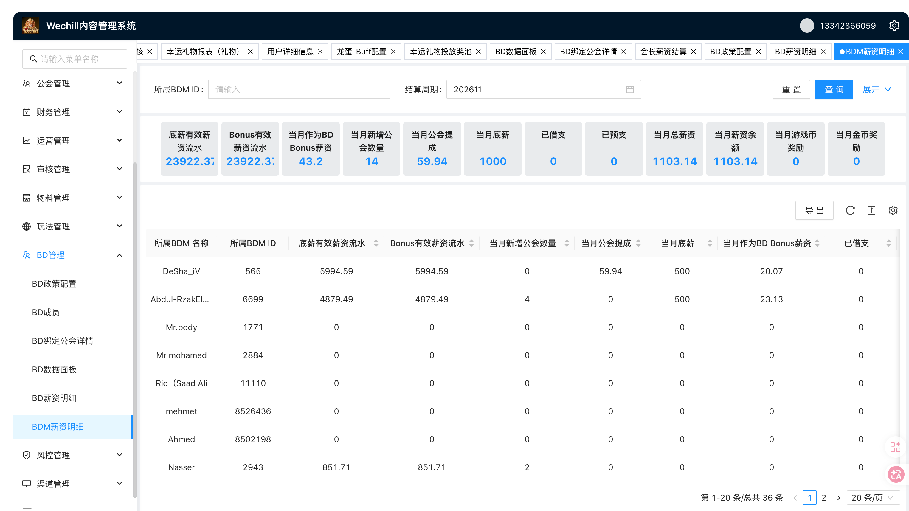

本页独立于BD薪资页；BDM定位、汇总、明细及导出仅取所选区。原“当月作为BD Bonus薪资”保留，不因分区新增合并公式。

##### 前置条件

具备原入口及操作权限，所选区在角色可管理范围内；首次无记忆或原区失权时从顶部选择器重新选区，不自动代选。后续查询、提交和审核均核对最新权限，失权区旧结果不能继续操作。

##### 触发方式

原BDM薪资按周期查询或导出。

##### 字段与数据来源

本页不新增其他业务字段，仅明确受分区影响的范围。

| 字段 | 说明 | 统计方式 | 数据来源 |
| --- | --- | --- | --- |
| 薪资查询／汇总／明细 | 限定本区BDM及本区关联数据，不将兼任BD当作另一管理区授权 | 沿原结算周期；Bonus沿原当月口径 | 原BDM薪资及兼任BD关系 |

##### 交互逻辑

本区定位BDM后沿原筛选、统计和导出；BDM管理收益与其BD Bonus不因切区被重复归集或自行合并。

##### 服务端核心逻辑

查询、定位及执行共同遵守3.3，不只过滤列表；不信任自报大区，不改原业务资格、金额及保存身份。非单用户／共享配置按本节明确范围处理，不强行套用某个用户的大区。

##### 状态设计

沿原业务状态，不新增状态流；本区／切区情形统一见3.3，模块特有边界见下文。菜单总览不补造独立业务状态。

##### 边界条件

目前不存在会长、公会、主播、BD／BDM不同区的情况，本次不新增跨区团队资格或贡献分配规则。已发生未结工资按原适用政策处理；新增记录取业务发起时对应用户的可信大区。未结束旧业务保留原用户、金额、价格和适用政策，缺可信身份时先核实。历史不补区，能关联可信用户的仍只查所选区，无法关联的由有原处理权限的人员核实，不开放全区查询。

##### 异常处理

原业务失败沿原流程；分区异常使用3.3已确认的共用提示，不返回其他区账号信息。未定义的默认、补偿或重试不自行补造。

##### 权限控制

角色可管理范围、顶部所选区及原入口／操作权共同生效；切区不产生新权限，也不迁移原对象归属。

### 5.22 BD绑定公会详情

#### 模块背景

将当前指定页面接入共用分区边界；只描述分区变化或原型范围，不复述原业务全字段。

#### 用户场景

操作人在有权限的所选大区进入本页，按原业务范围查询或处理。

#### 对应原型

当前Axure指定目录“BD绑定公会详情”；完整画布如下，缺少分区控件的现状截图仍按本文已确认共用要求处理。

#### 功能点：BD绑定公会详情分区范围

##### 功能说明

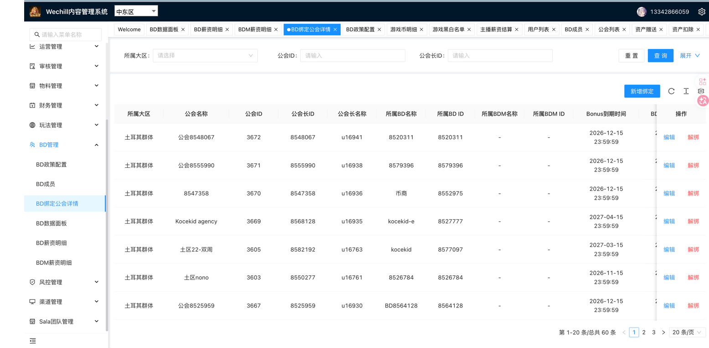

公会、会长及关联BD／BDM查询，以及原新增绑定、编辑、解绑，均受所选区边界约束。页面既有“所属大区”筛选不能扩大顶部范围。

##### 前置条件

具备原入口及操作权限，所选区在角色可管理范围内；首次无记忆或原区失权时从顶部选择器重新选区，不自动代选。后续查询、提交和审核均核对最新权限，失权区旧结果不能继续操作。

##### 触发方式

原查询、新增绑定、编辑、解绑。

##### 字段与数据来源

本页不新增其他业务字段，仅明确受分区影响的范围。

| 字段 | 说明 | 统计方式 | 数据来源 |
| --- | --- | --- | --- |
| 筛选／所属大区 | 只能在当前工作范围内缩小查询；不作为跨区入口 | 本次查询 | 原绑定关系及其归属 |

##### 交互逻辑

在所选区定位原业务对象并进入原关系操作；切区不迁移绑定关系或重算Bonus。页面原“所属大区”筛选与顶部大区同时生效，局部大区与顶部不一致时不返回其他区数据，不新增隐藏该字段的要求。

##### 服务端核心逻辑

查询、定位及执行共同遵守3.3，不只过滤列表；不信任自报大区，不改原业务资格、金额及保存身份。非单用户／共享配置按本节明确范围处理，不强行套用某个用户的大区。

##### 状态设计

沿原业务状态，不新增状态流；本区／切区情形统一见3.3，模块特有边界见下文。菜单总览不补造独立业务状态。

##### 边界条件

目前不存在会长、公会、主播、BD／BDM不同区的情况；绑定候选仍核对本区可信归属与原资格，不据此新增跨区资格或禁令。原型顶部与样例列不一致记入核对记录，不据此放开跨区。

##### 异常处理

原业务失败沿原流程；分区异常使用3.3已确认的共用提示，不返回其他区账号信息。未定义的默认、补偿或重试不自行补造。

##### 权限控制

角色可管理范围、顶部所选区及原入口／操作权共同生效；切区不产生新权限，也不迁移原对象归属。

### 5.23 BD目录内系统管理范围

#### 模块背景

将当前指定页面接入共用分区边界；只描述分区变化或原型范围，不复述原业务全字段。

#### 用户场景

操作人按原系统管理权限查看后台账号、角色及菜单；涉及具体业务对象的数据和日志时，再核对所选区及对应对象归属。

#### 对应原型

当前Axure指定目录“系统管理”；完整画布如下，缺少分区控件的现状截图仍按本文已确认共用要求处理。

#### 功能点：BD目录内系统管理范围分区范围

##### 功能说明

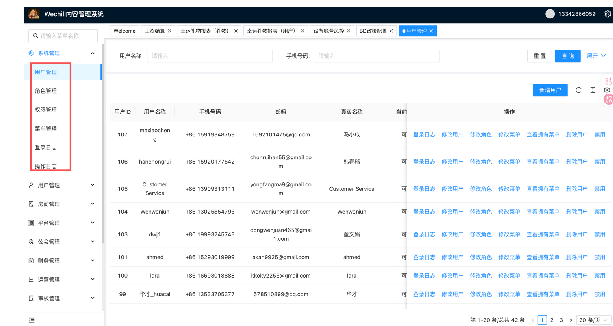

本页实际为后台管理账号列表，圈选用户、角色、权限、菜单、登录日志及操作日志；不是消费者用户页，也不是六张已提供的独立原型。角色大区配置由5.16的独立最新原型补齐。

##### 前置条件

具备原系统管理入口及操作权限；后台管理账号、菜单和纯系统日志不套用消费者用户分区。涉及分区业务对象时，所选区须在角色可管理范围内，查询、提交及审核核对最新权限。

##### 触发方式

查看本页及原有后台账号／角色入口。

##### 字段与数据来源

本页不新增字段；圈选菜单仅作范围证据，具体字段以已有功能或对应独立原型为准。

##### 交互逻辑

只登记圈选范围；不从菜单推定新增、隐藏或删除六项功能。后台管理账号、权限及菜单继续按原管理权限处理；业务操作日志随被操作对象区分，纯系统日志沿原权限，不统一按某个消费者账号归区。

##### 服务端核心逻辑

后台账号、权限／菜单及纯系统日志沿原管理权限校验；业务操作日志按被操作对象的可信业务归属限定范围。角色的大区授权与原操作权限分别核对，不能用一个角色的操作权限套用另一个角色的大区。

##### 状态设计

沿原业务状态，不新增状态流；本区／切区情形统一见3.3，模块特有边界见下文。菜单总览不补造独立业务状态。

##### 边界条件

多角色可管理区取并集，具体操作仍核对对应角色的原权限和获配大区；已有角色由管理员明确分配初始大区，不默认全区。角色按大区筛选时，包含该区即符合条件。角色独立配置页按5.16处理。

##### 异常处理

原业务失败沿原流程；分区异常使用3.3已确认的共用提示，不返回其他区账号信息。未定义的默认、补偿或重试不自行补造。

##### 权限控制

后台账号、权限／菜单及纯系统日志沿原管理权限，不因顶部选区新增权限或限制；业务对象及其操作日志同时核对角色获配区、顶部所选区与原操作权。

### 5.24 房间列表

#### 模块背景

将当前指定页面接入共用分区边界；只描述分区变化或原型范围，不复述原业务全字段。

#### 用户场景

操作人在有权限的所选大区进入本页，按原业务范围查询或处理。

#### 对应原型

当前Axure指定目录“房间列表”；完整画布如下，缺少分区控件的现状截图仍按本文已确认共用要求处理。

#### 功能点：房间列表分区范围

##### 功能说明

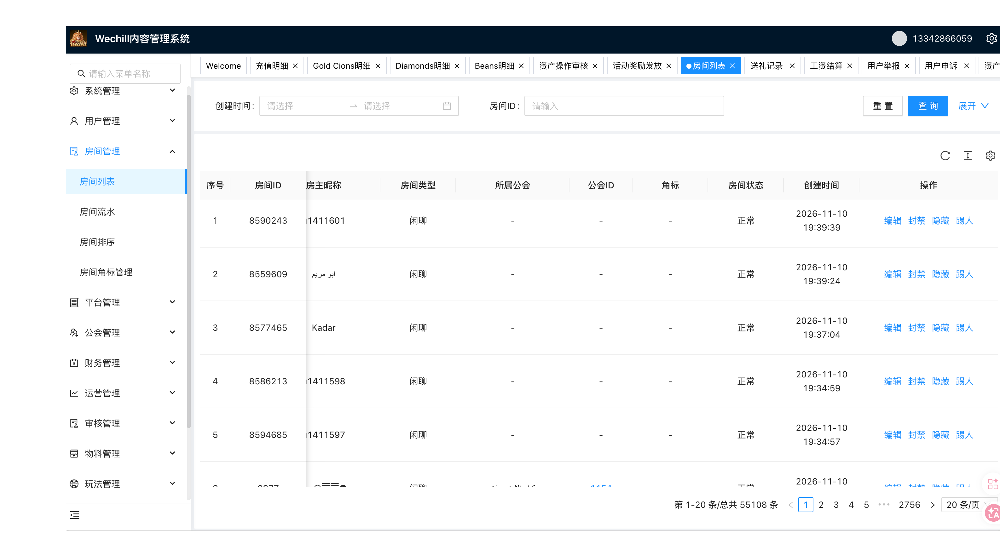

房间查询及原操作按房主的可信大区限定所选区，不按后台操作人归区。原定位入口是房间ID，不把房间ID改称用户ID／靓号，也不新增房间靓号能力。

##### 前置条件

具备原入口及操作权限，所选区在角色可管理范围内；首次无记忆或原区失权时从顶部选择器重新选区，不自动代选。后续查询、提交和审核均核对最新权限，失权区旧结果不能继续操作。

##### 触发方式

原房间列表查询及已有行操作。

##### 字段与数据来源

本页不新增其他业务字段，仅明确受分区影响的范围。

| 字段 | 说明 | 统计方式 | 数据来源 |
| --- | --- | --- | --- |
| 筛选／房间ID | 只定位所选区内符合原条件的房间 | 本次查询 | 房间标识及房主可信归属 |

##### 交互逻辑

切区重新按房主可信大区查询房间；查看详情和执行原行操作时使用同一归属主体校验，不能以公会或后台操作人的大区替代。

##### 服务端核心逻辑

查询、定位及执行共同遵守3.3，不只过滤列表；不信任自报大区，不改原业务资格、金额及保存身份。非单用户／共享配置按本节明确范围处理，不强行套用某个用户的大区。

##### 状态设计

沿原业务状态，不新增状态流；本区／切区情形统一见3.3，模块特有边界见下文。菜单总览不补造独立业务状态。

##### 边界条件

房主归属无法确认时先核实，不用任意关联用户补定大区；不因本次分区新增房间转让或迁移规则，也不展开相邻房间流水、排序和角标菜单。

##### 异常处理

原业务失败沿原流程；分区异常使用3.3已确认的共用提示，不返回其他区账号信息。未定义的默认、补偿或重试不自行补造。

##### 权限控制

角色可管理范围、顶部所选区及原入口／操作权共同生效；切区不产生新权限，也不迁移原对象归属。

### 5.25 用户列表

#### 模块背景

将当前指定页面接入共用分区边界；只描述分区变化或原型范围，不复述原业务全字段。

#### 用户场景

操作人在有权限的所选大区进入本页，按原业务范围查询或处理。

#### 对应原型

当前Axure指定目录“用户列表”；完整画布如下，缺少分区控件的现状截图仍按本文已确认共用要求处理。

#### 功能点：用户列表分区范围

##### 功能说明

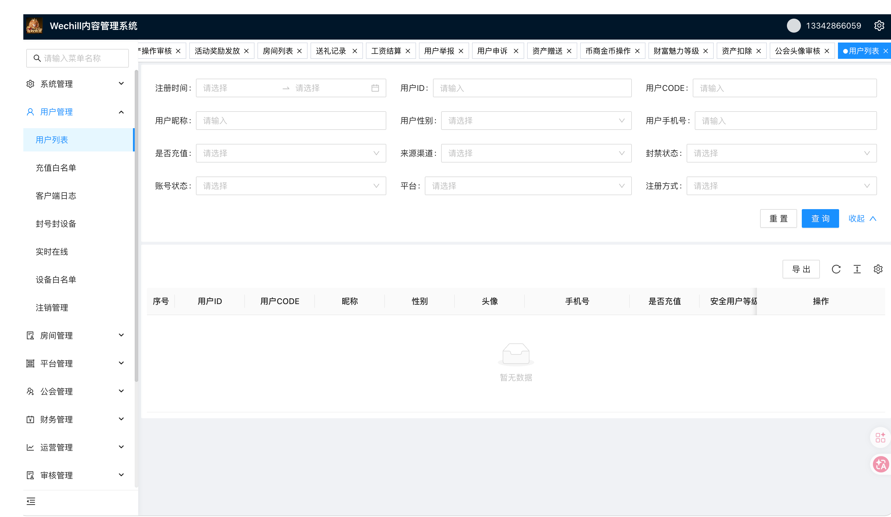

消费者用户查询、详情及原操作均限定所选区；用户ID／靓号输入只能在本区定位。原用户ID和用户CODE为不同字段，不仅凭名称认定CODE就是靓号。

##### 前置条件

具备原入口及操作权限，所选区在角色可管理范围内；首次无记忆或原区失权时从顶部选择器重新选区，不自动代选。后续查询、提交和审核均核对最新权限，失权区旧结果不能继续操作。

##### 触发方式

原查询、查看及已有操作。

##### 字段与数据来源

本页不新增其他业务字段，仅明确受分区影响的范围。

| 字段 | 说明 | 统计方式 | 数据来源 |
| --- | --- | --- | --- |
| 用户定位／用户ID与靓号 | 定位范围限本区；用户ID、用户CODE沿原账号对应关系查询，不改变含义 | 本次查询 | 服务端可信用户身份与归属 |

##### 交互逻辑

本区找到唯一真实用户后才取其本区资产、公会、BD等关联数据。空结果不回退外区；切区后旧详情不能用作新区目标。

##### 服务端核心逻辑

查询、定位及执行共同遵守3.3，不只过滤列表；不信任自报大区，不改原业务资格、金额及保存身份。非单用户／共享配置按本节明确范围处理，不强行套用某个用户的大区。

##### 状态设计

沿原业务状态，不新增状态流；本区／切区情形统一见3.3，模块特有边界见下文。菜单总览不补造独立业务状态。

##### 边界条件

用户ID、用户CODE与靓号沿原账号对应关系查询；不存在原始账号与靓号重复占用问题。不同区允许相同靓号，查询仍必须限定当前区。历史用户大区空值继续归EN，大区值不合法默认归中东区；资料冲突或IP误分的具体纠正方式仍待确认，本次不新增按IP自动改区能力。不新增用户切区、资产清理或其他原型未给出的账号能力。

##### 异常处理

原业务失败沿原流程；分区异常使用3.3已确认的共用提示，不返回其他区账号信息。未定义的默认、补偿或重试不自行补造。

##### 权限控制

角色可管理范围、顶部所选区及原入口／操作权共同生效；切区不产生新权限，也不迁移原对象归属。

### 5.26 充值白名单

#### 模块背景

将当前指定页面接入共用分区边界；只描述分区变化或原型范围，不复述原业务全字段。

#### 用户场景

操作人在有权限的所选大区进入本页，按原业务范围查询或处理。

#### 对应原型

当前Axure指定目录“充值白名单”；完整画布如下，缺少分区控件的现状截图仍按本文已确认共用要求处理。

#### 功能点：充值白名单分区范围

##### 功能说明

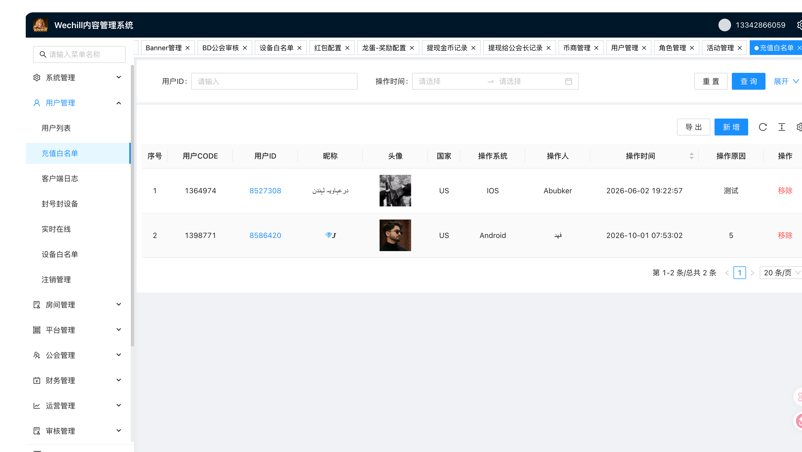

原白名单查询、新增、移除及导出接入所选区；通过用户定位操作名单时不能绕到其他区。

##### 前置条件

具备原入口及操作权限，所选区在角色可管理范围内；首次无记忆或原区失权时从顶部选择器重新选区，不自动代选。后续查询、提交和审核均核对最新权限，失权区旧结果不能继续操作。

##### 触发方式

原名单查询、新增、逐行移除或导出。

##### 字段与数据来源

本页不新增其他业务字段，仅明确受分区影响的范围。

| 字段 | 说明 | 统计方式 | 数据来源 |
| --- | --- | --- | --- |
| 名单目标用户／范围 | 限所选区定位；用户CODE不直接当作靓号 | 本次查询或操作 | 原白名单与目标用户关系 |

##### 交互逻辑

本区确定目标后沿原白名单流程执行；本次改变后台操作边界，不自行改变白名单对应的充值权益。

##### 服务端核心逻辑

查询、定位及执行共同遵守3.3，不只过滤列表；不信任自报大区，不改原业务资格、金额及保存身份。非单用户／共享配置按本节明确范围处理，不强行套用某个用户的大区。

##### 状态设计

沿原业务状态，不新增状态流；本区／切区情形统一见3.3，模块特有边界见下文。菜单总览不补造独立业务状态。

##### 边界条件

新增名单记录取业务发起时服务端确认的目标用户大区。历史名单不补区，能关联可信用户的仍只查所选区；无法关联的由有原处理权限的人员核实，不开放全区查询。白名单原充值权益及其生效范围不变，不类推游戏名单互斥。

##### 异常处理

原业务失败沿原流程；分区异常使用3.3已确认的共用提示，不返回其他区账号信息。未定义的默认、补偿或重试不自行补造。

##### 权限控制

角色可管理范围、顶部所选区及原入口／操作权共同生效；切区不产生新权限，也不迁移原对象归属。

### 5.27 封号封设备

#### 模块背景

将当前指定页面接入共用分区边界；只描述分区变化或原型范围，不复述原业务全字段。

#### 用户场景

操作人在有权限的所选大区进入本页，按原业务范围查询或处理。

#### 对应原型

当前Axure指定目录“封号封设备”；完整画布如下，缺少分区控件的现状截图仍按本文已确认共用要求处理。

#### 功能点：封号封设备分区范围

##### 功能说明

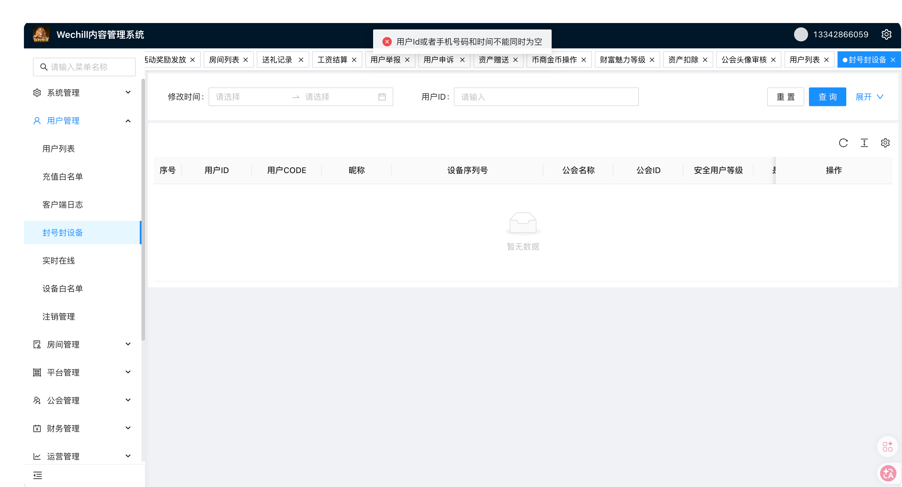

原账号／设备相关查询及处理接入所选区，但后台可操作范围不等于封设备影响仅限本区。设备可能关联多区用户，不能按登录操作人给设备归区。

##### 前置条件

具备原入口及操作权限，所选区在角色可管理范围内；首次无记忆或原区失权时从顶部选择器重新选区，不自动代选。后续查询、提交和审核均核对最新权限，失权区旧结果不能继续操作。

##### 触发方式

原查询及已有封禁／解封流程。

##### 字段与数据来源

本页不新增其他业务字段，仅明确受分区影响的范围。

| 字段 | 说明 | 统计方式 | 数据来源 |
| --- | --- | --- | --- |
| 账号与设备定位范围 | 区分目标用户与设备关联；设备号不是用户ID／靓号 | 本次查询／操作 | 原账号、设备及封禁关系 |

##### 交互逻辑

本区定位用户，设备关联信息只展示当前区有权查看的数据。执行封禁／解封前核实实际影响范围；若会影响其他区，必须按原权限核实，不能当作“仅操作本区”直接执行。原手机号／时间校验提示沿用，不重写其未明确的布尔关系。

##### 服务端核心逻辑

查询、定位及执行共同遵守3.3，不只过滤列表；不信任自报大区，不改原业务资格、金额及保存身份。非单用户／共享配置按本节明确范围处理，不强行套用某个用户的大区。

##### 状态设计

沿原业务状态，不新增状态流；本区／切区情形统一见3.3，模块特有边界见下文。菜单总览不补造独立业务状态。

##### 边界条件

共享设备不按某个任意关联用户或操作人归区；本次只明确展示与操作核实边界，不改变设备原封禁效力，不新增全局封禁政策。

##### 异常处理

原业务失败沿原流程；分区异常使用3.3已确认的共用提示，不返回其他区账号信息。未定义的默认、补偿或重试不自行补造。

##### 权限控制

角色可管理范围、顶部所选区及原入口／操作权共同生效；切区不产生新权限，也不迁移原对象归属。

### 5.28 设备白名单

#### 模块背景

将当前指定页面接入共用分区边界；只描述分区变化或原型范围，不复述原业务全字段。

#### 用户场景

操作人在有权限的所选大区进入本页，按原业务范围查询或处理。

#### 对应原型

当前Axure指定目录“设备白名单”；完整画布如下，缺少分区控件的现状截图仍按本文已确认共用要求处理。

#### 功能点：设备白名单分区范围

##### 功能说明

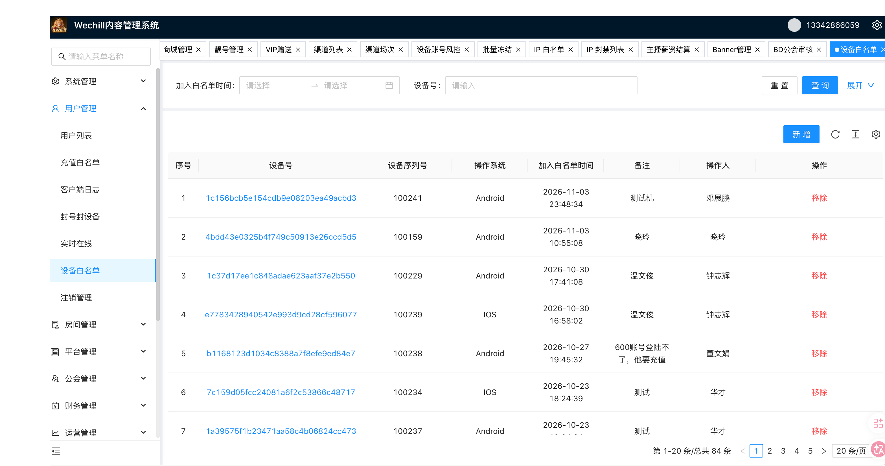

设备白名单原查询、新增、移除接入所选区范围；设备不是消费者账号，不能将设备号当作用户ID／靓号或由备注中的账号猜设备归区。

##### 前置条件

具备原入口及操作权限，所选区在角色可管理范围内；首次无记忆或原区失权时从顶部选择器重新选区，不自动代选。后续查询、提交和审核均核对最新权限，失权区旧结果不能继续操作。

##### 触发方式

原设备名单查询、新增或移除。

##### 字段与数据来源

本页不新增其他业务字段，仅明确受分区影响的范围。

| 字段 | 说明 | 统计方式 | 数据来源 |
| --- | --- | --- | --- |
| 设备名单／范围 | 设备与关联账号分别识别，只展示当前区有权查看的关联数据 | 本次查询／操作 | 原设备白名单及真实设备关联 |

##### 交互逻辑

保持设备名单原查询、新增及移除流程，只展示当前区有权查看的关联数据。新增或移除若会实际影响其他区，先按原权限核实影响范围，不能把共享设备当成本区独占对象直接处理。

##### 服务端核心逻辑

查询、定位及执行共同遵守3.3，不只过滤列表；不信任自报大区，不改原业务资格、金额及保存身份。非单用户／共享配置按本节明确范围处理，不强行套用某个用户的大区。

##### 状态设计

沿原业务状态，不新增状态流；本区／切区情形统一见3.3，模块特有边界见下文。菜单总览不补造独立业务状态。

##### 边界条件

共享设备不按任意一个关联账号或操作人归区；原豁免效力及其与封禁的优先关系不变，不新增设备独占规则，也不把顶部筛选误当作实际影响仅限本区。

##### 异常处理

原业务失败沿原流程；分区异常使用3.3已确认的共用提示，不返回其他区账号信息。未定义的默认、补偿或重试不自行补造。

##### 权限控制

角色可管理范围、顶部所选区及原入口／操作权共同生效；切区不产生新权限，也不迁移原对象归属。

### 5.29 注销管理

#### 模块背景

将当前指定页面接入共用分区边界；只描述分区变化或原型范围，不复述原业务全字段。

#### 用户场景

操作人在有权限的所选大区进入本页，按原业务范围查询或处理。

#### 对应原型

当前Axure指定目录“注销管理”；完整画布如下，缺少分区控件的现状截图仍按本文已确认共用要求处理。

#### 功能点：注销管理分区范围

##### 功能说明

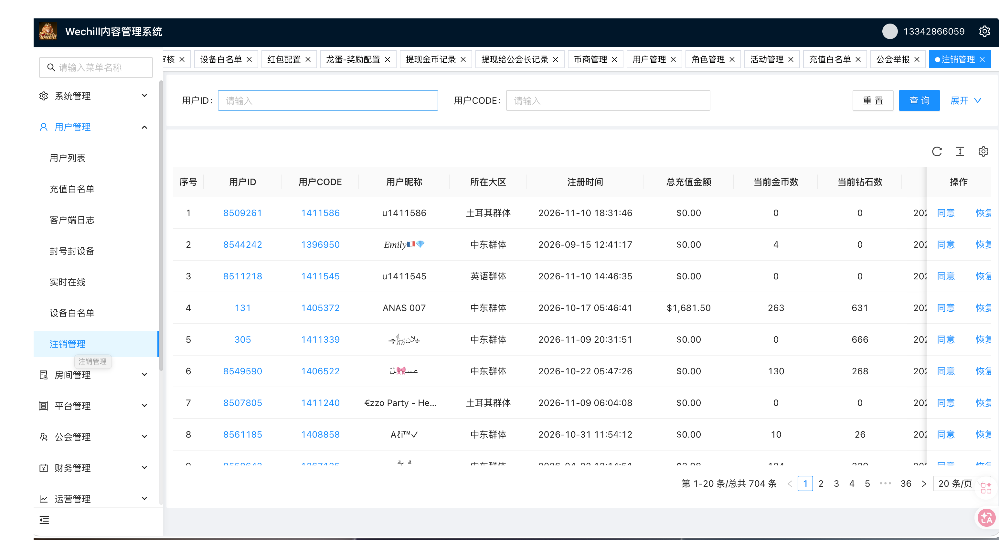

注销记录查询、原同意及恢复操作只在所选区内进行；使用原申请对应真实账号，不因号码变化恢复到另一个用户。

##### 前置条件

具备原入口及操作权限，所选区在角色可管理范围内；首次无记忆或原区失权时从顶部选择器重新选区，不自动代选。后续查询、提交和审核均核对最新权限，失权区旧结果不能继续操作。

##### 触发方式

原注销查询、同意或恢复。

##### 字段与数据来源

本页不新增其他业务字段，仅明确受分区影响的范围。

| 字段 | 说明 | 统计方式 | 数据来源 |
| --- | --- | --- | --- |
| 列表／所在大区 | 原列展示归属；查询和操作不能突破顶部所选区 | 沿原申请及查询时间口径 | 原注销申请及其用户关系 |

##### 交互逻辑

本区确定注销对象后沿原允许状态处理；新增注销记录取业务发起时服务端确认的对应用户大区，不取后台操作人归属。查询、同意及恢复仍核对当前工作区与可信用户归属，记录大区不能替代权限校验；切区不迁移注销账号，也不改原申请身份。

##### 服务端核心逻辑

查询、定位及执行共同遵守3.3，不只过滤列表；不信任自报大区，不改原业务资格、金额及保存身份。非单用户／共享配置按本节明确范围处理，不强行套用某个用户的大区。

##### 状态设计

沿原业务状态，不新增状态流；本区／切区情形统一见3.3，模块特有边界见下文。菜单总览不补造独立业务状态。

##### 边界条件

原同意／恢复资格沿用；未结束旧申请保留原用户身份，缺少可信身份时先核实，不按当前号码猜人。历史不补区，能关联可信用户的仍只查所选区；无法关联的由有原处理权限的人员核实，不开放全区查询，也不从旧多区示例推出跨区恢复。

##### 异常处理

原业务失败沿原流程；分区异常使用3.3已确认的共用提示，不返回其他区账号信息。未定义的默认、补偿或重试不自行补造。

##### 权限控制

角色可管理范围、顶部所选区及原入口／操作权共同生效；切区不产生新权限，也不迁移原对象归属。

### 5.30 公会头像审核

#### 模块背景

将当前指定页面接入共用分区边界；只描述分区变化或原型范围，不复述原业务全字段。

#### 用户场景

操作人在有权限的所选大区进入本页，按原业务范围查询或处理。

#### 对应原型

当前Axure指定目录“公会头像审核”；完整画布如下，缺少分区控件的现状截图仍按本文已确认共用要求处理。

#### 功能点：公会头像审核分区范围

##### 功能说明

审核列表、预览及原通过／拒绝、一键通过均按公会所属区接入所选区；公会、会长及审核单分别识别，不能用会长或审核人的归属替代公会归属。

##### 前置条件

具备原入口及操作权限，所选区在角色可管理范围内；首次无记忆或原区失权时从顶部选择器重新选区，不自动代选。后续查询、提交和审核均核对最新权限，失权区旧结果不能继续操作。

##### 触发方式

原审核查询、预览及单笔／一键审核。

##### 字段与数据来源

本页不新增其他业务字段，仅明确受分区影响的范围。

| 字段 | 说明 | 统计方式 | 数据来源 |
| --- | --- | --- | --- |
| 审核列表／预览／范围 | 按公会所属区限定所选区，不按会长或审核人归区 | 沿原申请／审核时间条件 | 原公会头像申请及原目标身份 |

##### 交互逻辑

按公会所属区选取本区原申请，再沿原流程审核；执行使用原申请身份，不按当前号码重找。一键通过先检查整批目标；存在混区、查无目标、无法唯一识别或重复目标时，整批不执行并列出问题项。检查通过后逐条执行、逐条展示成功或失败；重试只处理失败项，已成功项不得重复审批。

##### 服务端核心逻辑

查询、定位及执行共同遵守3.3，不只过滤列表；不信任自报大区，不改原业务资格、金额及保存身份。非单用户／共享配置按本节明确范围处理，不强行套用某个用户的大区。

##### 状态设计

沿原业务状态，不新增状态流；本区／切区情形统一见3.3，模块特有边界见下文。菜单总览不补造独立业务状态。

##### 边界条件

目前不存在会长、公会、主播、BD／BDM不同区的情况，不新增跨区组织资格或禁令。历史记录不补区，仍按可信公会归属限定本区；旧在途申请保留原申请及目标身份，无法确认关联时由有原处理权限的人员核实，不按号码猜人，不开放全区查询。

##### 异常处理

原业务失败沿原流程；分区异常使用3.3已确认的共用提示，不返回其他区账号信息。未定义的默认、补偿或重试不自行补造。

##### 权限控制

角色可管理范围、顶部所选区及原入口／操作权共同生效；切区不产生新权限，也不迁移原对象归属。

### 5.31 BD公会审核

#### 模块背景

将当前指定页面接入共用分区边界；只描述分区变化或原型范围，不复述原业务全字段。

#### 用户场景

操作人在有权限的所选大区进入本页，按原业务范围查询或处理。

#### 对应原型

当前Axure指定目录“BD公会审核”；完整画布如下，缺少分区控件的现状截图仍按本文已确认共用要求处理。

#### 功能点：BD公会审核分区范围

##### 功能说明

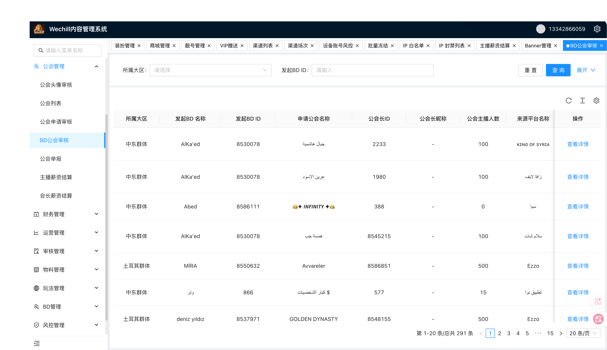

原审核查询、所属大区筛选、列表及查看详情按申请公会所属区接入所选区，不按发起BD归区；原所属大区筛选不能扩大顶部工作区。

##### 前置条件

具备原入口及操作权限，所选区在角色可管理范围内；首次无记忆或原区失权时从顶部选择器重新选区，不自动代选。后续查询、提交和审核均核对最新权限，失权区旧结果不能继续操作。

##### 触发方式

原审核查询、查看详情及原审核流程。

##### 字段与数据来源

本页不新增其他业务字段，仅明确受分区影响的范围。

| 字段 | 说明 | 统计方式 | 数据来源 |
| --- | --- | --- | --- |
| 筛选／所属大区 | 与顶部范围同时生效；与顶部大区不一致时不返回其他区数据 | 本次查询 | 原审核记录及关联业务对象 |

##### 交互逻辑

区分发起BD、申请公会、会长与后台操作人；按申请公会所属区确定审核记录、详情与操作范围，不用其他主体替代。页面原“所属大区”筛选与顶部大区同时生效，不能靠局部筛选返回外区申请。未给出的详情字段不补写。

##### 服务端核心逻辑

查询、定位及执行共同遵守3.3，不只过滤列表；不信任自报大区，不改原业务资格、金额及保存身份。非单用户／共享配置按本节明确范围处理，不强行套用某个用户的大区。

##### 状态设计

沿原业务状态，不新增状态流；本区／切区情形统一见3.3，模块特有边界见下文。菜单总览不补造独立业务状态。

##### 边界条件

目前不存在会长、公会、主播、BD／BDM不同区的情况，本次不新增跨区关系资格或禁令。历史记录不补区，仍按可信申请公会归属限定本区；旧在途申请保留原身份和原业务关系，缺少可信关联时由有原处理权限的人员核实，不开放全区查询。不新增申请入口或审核层级。

##### 异常处理

原业务失败沿原流程；分区异常使用3.3已确认的共用提示，不返回其他区账号信息。未定义的默认、补偿或重试不自行补造。

##### 权限控制

角色可管理范围、顶部所选区及原入口／操作权共同生效；切区不产生新权限，也不迁移原对象归属。

### 5.32 主播薪资结算

#### 模块背景

将当前指定页面接入共用分区边界；只描述分区变化或原型范围，不复述原业务全字段。

#### 用户场景

操作人在有权限的所选大区进入本页，按原业务范围查询或处理。

#### 对应原型

当前Axure指定目录“主播薪资结算”；完整画布如下，缺少分区控件的现状截图仍按本文已确认共用要求处理。

#### 功能点：主播薪资结算分区范围

##### 功能说明

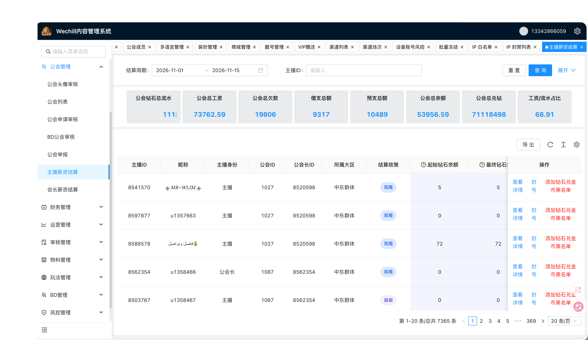

现有主播定位、薪资汇总、明细、详情及导出限定所选区；已有管理入口仍按原权限，不新增发薪或手动结算能力。

##### 前置条件

具备原入口及操作权限，所选区在角色可管理范围内；首次无记忆或原区失权时从顶部选择器重新选区，不自动代选。后续查询、提交和审核均核对最新权限，失权区旧结果不能继续操作。

##### 触发方式

原按主播及周期查询、导出、详情与已有行操作。

##### 字段与数据来源

本页不新增其他业务字段，仅明确受分区影响的范围。

| 字段 | 说明 | 统计方式 | 数据来源 |
| --- | --- | --- | --- |
| 薪资查询／汇总／明细 | 限本区业务；会长兼主播的个人收益不与管理收益自行合并 | 沿原结算周期／筛选，不重新计时 | 原主播薪资记录及关联公会 |

##### 交互逻辑

本区定位主播，按原口径查询及处理；同账号兼任会长不新增合并或重复统计。各类已有统计、导出和详情均不能含外区数据。

##### 服务端核心逻辑

查询、定位及执行共同遵守3.3，不只过滤列表；不信任自报大区，不改原业务资格、金额及保存身份。非单用户／共享配置按本节明确范围处理，不强行套用某个用户的大区。

##### 状态设计

沿原业务状态，不新增状态流；本区／切区情形统一见3.3，模块特有边界见下文。菜单总览不补造独立业务状态。

##### 边界条件

目前不存在会长、公会、主播、BD／BDM不同区的情况，不因双身份新增跨区资格或合并收益。已发生未结工资按原适用政策处理，不追算旧工资；公会新政策使用正式批准的政策表，自明确的业务生效时点作用于新增业务，具体数值、切换日期及账期待负责人提供，不在本页填造。新增记录取业务发起时对应用户的可信大区；旧在途保留原用户、金额、价格及政策，缺可信身份先核实。历史不补区，能关联可信用户的仍只查所选区，无法关联的由有原处理权限的人员核实，不开放全区查询。

##### 异常处理

原业务失败沿原流程；分区异常使用3.3已确认的共用提示，不返回其他区账号信息。未定义的默认、补偿或重试不自行补造。

##### 权限控制

角色可管理范围、顶部所选区及原入口／操作权共同生效；切区不产生新权限，也不迁移原对象归属。

### 5.33 会长薪资结算

#### 模块背景

将当前指定页面接入共用分区边界；只描述分区变化或原型范围，不复述原业务全字段。

#### 用户场景

操作人在有权限的所选大区进入本页，按原业务范围查询或处理。

#### 对应原型

当前Axure指定目录“会长薪资结算”；完整画布如下，缺少分区控件的现状截图仍按本文已确认共用要求处理。

#### 功能点：会长薪资结算分区范围

##### 功能说明

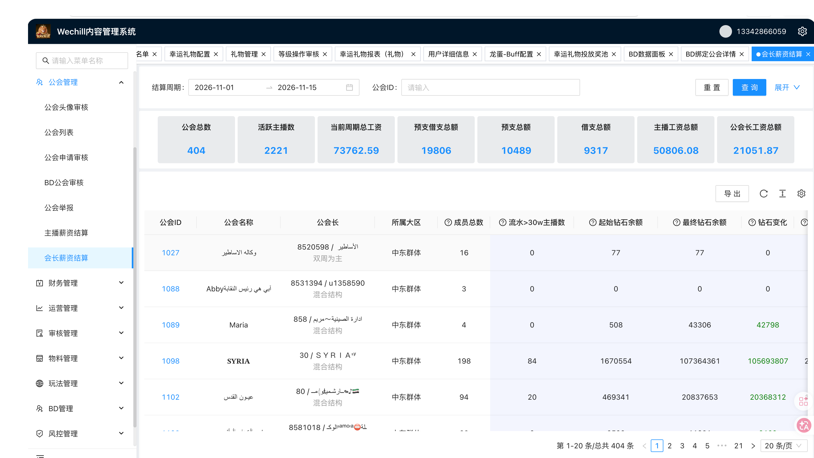

原公会ID查询、主播／会长工资汇总、列表及导出限定所选区；原查询主体是公会ID，不新增会长ID／靓号查询框。

##### 前置条件

具备原入口及操作权限，所选区在角色可管理范围内；首次无记忆或原区失权时从顶部选择器重新选区，不自动代选。后续查询、提交和审核均核对最新权限，失权区旧结果不能继续操作。

##### 触发方式

原按公会及周期查询、导出和已有下钻。

##### 字段与数据来源

本页不新增其他业务字段，仅明确受分区影响的范围。

| 字段 | 说明 | 统计方式 | 数据来源 |
| --- | --- | --- | --- |
| 公会查询／薪资汇总／明细 | 限所选区；保留主播工资与会长工资原区分 | 沿原结算周期／筛选 | 原公会结算及会长关系 |

##### 交互逻辑

以本区公会进入原结算查询；目前不存在会长、公会、主播、BD／BDM不同区的情况，不据此新增跨区资格或贡献分配规则。会长本人主播收益与管理收益仍按原规则区分；旧业务保留原用户身份和收款人，不因切区或按当前号码重新定位而改收款人。

##### 服务端核心逻辑

查询、定位及执行共同遵守3.3，不只过滤列表；不信任自报大区，不改原业务资格、金额及保存身份。非单用户／共享配置按本节明确范围处理，不强行套用某个用户的大区。

##### 状态设计

沿原业务状态，不新增状态流；本区／切区情形统一见3.3，模块特有边界见下文。菜单总览不补造独立业务状态。

##### 边界条件

原页没有明确发薪／修改工资能力，不新增。已发生未结工资按原适用政策处理，不追算旧工资；公会新政策使用正式批准的政策表，自明确的业务生效时点作用于新增业务，具体数值、切换日期及账期待负责人提供。旧在途保留原金额、价格和政策，缺少可信身份先核实。历史不补区，能关联可信业务对象的仍只查所选区，无法关联的由有原处理权限的人员核实，不开放全区查询。

##### 异常处理

原业务失败沿原流程；分区异常使用3.3已确认的共用提示，不返回其他区账号信息。未定义的默认、补偿或重试不自行补造。

##### 权限控制

角色可管理范围、顶部所选区及原入口／操作权共同生效；切区不产生新权限，也不迁移原对象归属。

### 5.34 公会举报

#### 模块背景

将当前指定页面接入共用分区边界；只描述分区变化或原型范围，不复述原业务全字段。

#### 用户场景

操作人在有权限的所选大区进入本页，按原业务范围查询或处理。

#### 对应原型

当前Axure指定目录“公会举报”；完整画布如下，缺少分区控件的现状截图仍按本文已确认共用要求处理。

#### 功能点：公会举报分区范围

##### 功能说明

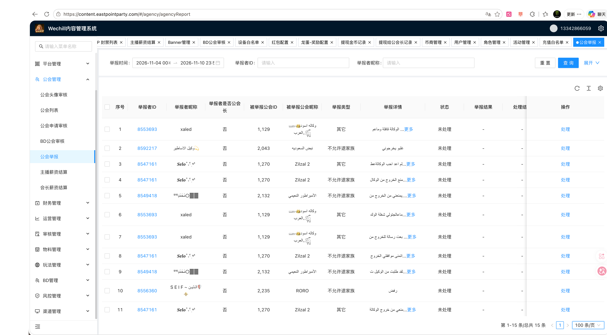

举报查询及原逐条处理入口按被举报公会所属区接入所选区，不按举报人归区；保留原举报者查询条件，不把查询字段改成归区主体。

##### 前置条件

具备原入口及操作权限，所选区在角色可管理范围内；首次无记忆或原区失权时从顶部选择器重新选区，不自动代选。后续查询、提交和审核均核对最新权限，失权区旧结果不能继续操作。

##### 触发方式

原举报查询、逐条处理。

##### 字段与数据来源

本页不新增其他业务字段，仅明确受分区影响的范围。

| 字段 | 说明 | 统计方式 | 数据来源 |
| --- | --- | --- | --- |
| 举报记录／处理目标 | 按被举报公会所属区确定记录范围，举报人及会长不替代该主体 | 沿原举报／筛选时间 | 原举报记录及双方关系 |

##### 交互逻辑

按被举报公会所属区查找本区原记录并沿原逐条流程处理；不因同一举报者和公会重复出现就合并记录，也不因举报人不在本区而改归举报人区。不新增跨区举报禁令或处罚。

##### 服务端核心逻辑

查询、定位及执行共同遵守3.3，不只过滤列表；不信任自报大区，不改原业务资格、金额及保存身份。非单用户／共享配置按本节明确范围处理，不强行套用某个用户的大区。

##### 状态设计

沿原业务状态，不新增状态流；本区／切区情形统一见3.3，模块特有边界见下文。菜单总览不补造独立业务状态。

##### 边界条件

记录范围由被举报公会决定；本次不扩大原处理权限或改变原处罚效力。原处理弹窗未给出，不造处罚方式与审批流。

##### 异常处理

原业务失败沿原流程；分区异常使用3.3已确认的共用提示，不返回其他区账号信息。未定义的默认、补偿或重试不自行补造。

##### 权限控制

角色可管理范围、顶部所选区及原入口／操作权共同生效；切区不产生新权限，也不迁移原对象归属。

### 5.35 资产操作审核

#### 模块背景

将当前指定页面接入共用分区边界；只描述分区变化或原型范围，不复述原业务全字段。

#### 用户场景

操作人在有权限的所选大区进入本页，按原业务范围查询或处理。

#### 对应原型

当前Axure指定目录“资产操作审核”；完整画布如下，缺少分区控件的现状截图仍按本文已确认共用要求处理。

#### 功能点：资产操作审核分区范围

##### 功能说明

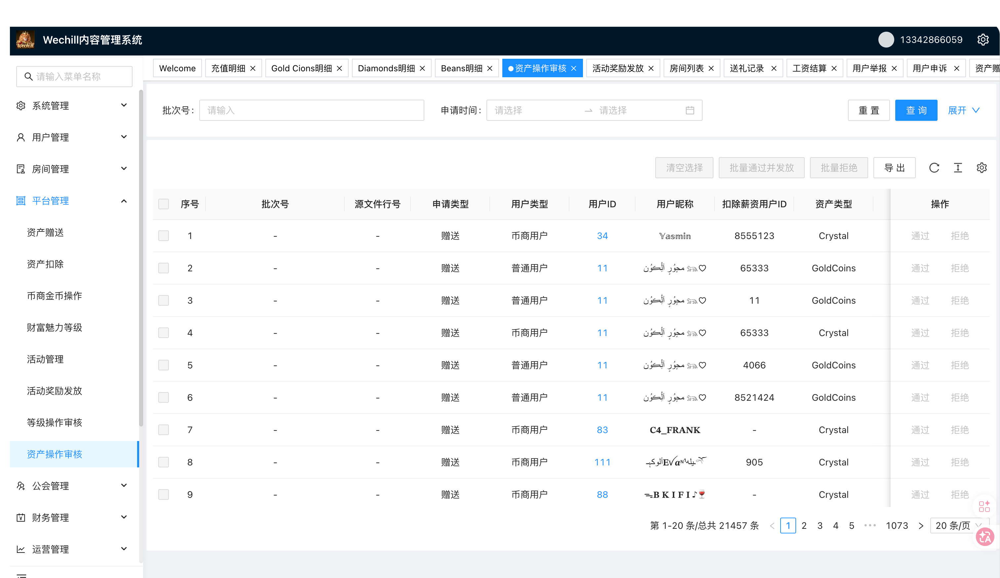

原逐行通过／拒绝、批量通过并发放及批量拒绝均按资产目标用户的可信大区限定所选区；包括普通用户和币商，不只覆盖一种用户类型。另行核对扣薪方归属及原扣薪资格，不用目标用户一方的权限替代扣薪方校验。

##### 前置条件

具备原入口及操作权限，所选区在角色可管理范围内；首次无记忆或原区失权时从顶部选择器重新选区，不自动代选。后续查询、提交和审核均核对最新权限，失权区旧结果不能继续操作。

##### 触发方式

原审核查询、单笔或原批量审核。

##### 字段与数据来源

本页不新增其他业务字段，仅明确受分区影响的范围。

| 字段 | 说明 | 统计方式 | 数据来源 |
| --- | --- | --- | --- |
| 审核目标／扣薪用户 | 按资产目标用户确定记录范围，扣薪用户的归属与原扣薪资格另检，不按操作人归区 | 沿原申请时间及本次执行 | 原申请固定身份与原业务关系 |

##### 交互逻辑

按申请、批次和源文件原行逐一保持目标身份，不能只校验批次首行；资产目标用户决定记录范围，扣薪方另核归属和原资格。批量通过并发放及批量拒绝先检查整批目标；出现混区、查无目标、无法唯一识别或重复目标时，整批不执行并列出问题项。检查通过后逐条执行、逐条展示成功或失败，重试只处理失败项，已成功项不得重复发放或审批。执行不改金额、不改收款人、不按号码重找。

##### 服务端核心逻辑

查询、定位及执行共同遵守3.3，不只过滤列表；不信任自报大区，不改原业务资格、金额及保存身份。非单用户／共享配置按本节明确范围处理，不强行套用某个用户的大区。

##### 状态设计

沿原业务状态，不新增状态流；本区／切区情形统一见3.3，模块特有边界见下文。菜单总览不补造独立业务状态。

##### 边界条件

资产目标用户与扣薪方不同区时，该入口是否允许及如何处理仍待逐项确认，不能仅凭一方在本区就执行，也不新增所有跨区关系一律禁止的规则。新增记录取业务发起时资产目标用户的可信大区；旧在途保留原用户、金额、价格和政策，缺少可信身份时先核实。历史不补区，能关联可信目标用户的仍只查所选区，无法关联的由有原处理权限的人员核实，不开放全区查询。不新增审核层级。

##### 异常处理

原业务失败沿原流程；分区异常使用3.3已确认的共用提示，不返回其他区账号信息。未定义的默认、补偿或重试不自行补造。

##### 权限控制

角色可管理范围、顶部所选区及原入口／操作权共同生效；切区不产生新权限，也不迁移原对象归属。

### 5.36 等级操作审核

#### 模块背景

将当前指定页面接入共用分区边界；只描述分区变化或原型范围，不复述原业务全字段。

#### 用户场景

操作人在有权限的所选大区进入本页，按原业务范围查询或处理。

#### 对应原型

当前Axure指定目录“等级操作审核”；完整画布如下，缺少分区控件的现状截图仍按本文已确认共用要求处理。

#### 功能点：等级操作审核分区范围

##### 功能说明

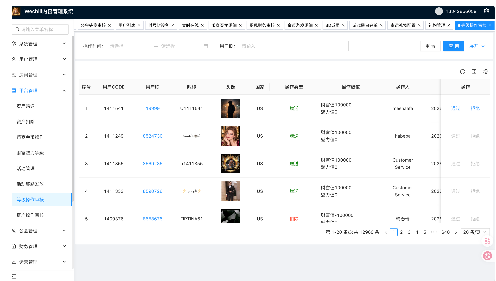

目标用户查询及原逐行通过／拒绝接入所选区，衔接5.6人工等级操作；不是普通资产审核，不新增批量入口。

##### 前置条件

具备原入口及操作权限，所选区在角色可管理范围内；首次无记忆或原区失权时从顶部选择器重新选区，不自动代选。后续查询、提交和审核均核对最新权限，失权区旧结果不能继续操作。

##### 触发方式

原等级审核查询或逐行通过／拒绝。

##### 字段与数据来源

本页不新增其他业务字段，仅明确受分区影响的范围。

| 字段 | 说明 | 统计方式 | 数据来源 |
| --- | --- | --- | --- |
| 等级目标／操作人 | 范围围绕原等级变更目标，不能以操作人或当前审核人替代 | 沿原操作时间／审核流程 | 原等级申请固定目标与操作人记录 |

##### 交互逻辑

审核使用原等级变更目标身份并复核本区及原权限；当前图未定义操作人等于申请人，不补造该关系，也不因按钮颜色推定豁免。

##### 服务端核心逻辑

查询、定位及执行共同遵守3.3，不只过滤列表；不信任自报大区，不改原业务资格、金额及保存身份。非单用户／共享配置按本节明确范围处理，不强行套用某个用户的大区。

##### 状态设计

沿原业务状态，不新增状态流；本区／切区情形统一见3.3，模块特有边界见下文。菜单总览不补造独立业务状态。

##### 边界条件

用户ID、用户CODE沿原账号对应关系查询，跨区同靓号仍只能在所选区定位。新增记录取业务发起时等级目标用户的可信大区；旧在途沿原申请固定目标，缺少可信身份先核实，不按号码猜人。历史不补区，能关联可信用户的仍只查所选区，无法关联的由有原处理权限的人员核实，不开放全区查询。不改原等级算法、自审规则或审核层级。

##### 异常处理

原业务失败沿原流程；分区异常使用3.3已确认的共用提示，不返回其他区账号信息。未定义的默认、补偿或重试不自行补造。

##### 权限控制

角色可管理范围、顶部所选区及原入口／操作权共同生效；切区不产生新权限，也不迁移原对象归属。

### 5.37 VIP赠送：1.0沿用与本轮范围

#### 模块背景

将当前指定页面接入共用分区边界；只描述分区变化或原型范围，不复述原业务全字段。

#### 用户场景

操作人在有权限的所选大区进入本页，按原业务范围查询或处理。

#### 对应原型

当前Axure指定目录“VIP赠送”；完整画布如下，缺少分区控件的现状截图仍按本文已确认共用要求处理。

#### 功能点：VIP赠送：1.0沿用与本轮范围分区范围

##### 功能说明

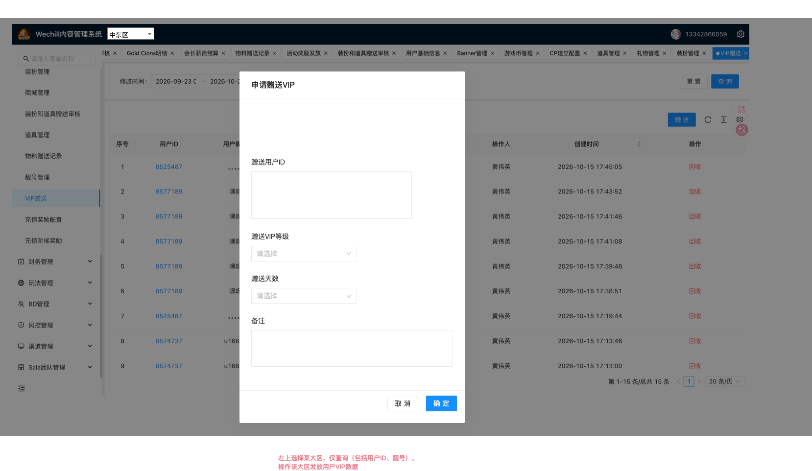

VIP赠送功能、等级、天数及原回收规则继续沿用1.0；当前页只补本轮角色授权及所选区对查询、定位与原操作的约束，不重写既有字段。

##### 前置条件

具备原入口及操作权限，所选区在角色可管理范围内；首次无记忆或原区失权时从顶部选择器重新选区，不自动代选。后续查询、提交和审核均核对最新权限，失权区旧结果不能继续操作。

##### 触发方式

原VIP查询、申请赠送及回收。

##### 字段与数据来源

本页不新增其他业务字段，仅明确受分区影响的范围。

| 字段 | 说明 | 统计方式 | 数据来源 |
| --- | --- | --- | --- |
| VIP发放目标／查询范围 | 仅在所选区定位与处理，不因超管可选全部而全区查询 | 沿原赠送／查询时间口径 | 原VIP发放关系及真实目标用户 |

##### 交互逻辑

本区定位原目标后进入1.0流程；原批量规则仍按1.0，不借本页给其他模块定义同一批量策略。VIP存量天数、等级和权益不变，仅售价变化。

##### 服务端核心逻辑

查询、定位及执行共同遵守3.3，不只过滤列表；不信任自报大区，不改原业务资格、金额及保存身份。非单用户／共享配置按本节明确范围处理，不强行套用某个用户的大区。

##### 状态设计

沿原业务状态，不新增状态流；本区／切区情形统一见3.3，模块特有边界见下文。菜单总览不补造独立业务状态。

##### 边界条件

1.0未被本轮改变的字段和流程保留，原VIP批量规则不外推到其他模块。新增记录取业务发起时VIP目标用户的可信大区；旧在途保留原用户、金额、价格及权益，缺可信身份先核实。历史不补区，能关联可信用户的仍只查所选区，无法关联的由有原处理权限的人员核实，不开放全区查询。切区和提示按3.3共用规则处理。

##### 异常处理

原业务失败沿原流程；分区异常使用3.3已确认的共用提示，不返回其他区账号信息。未定义的默认、补偿或重试不自行补造。

##### 权限控制

角色可管理范围、顶部所选区及原入口／操作权共同生效；切区不产生新权限，也不迁移原对象归属。

### 5.38 物料管理总览范围

#### 模块背景

将当前指定页面接入共用分区边界；只描述分区变化或原型范围，不复述原业务全字段。

#### 用户场景

操作人在有权限的所选大区进入本页，按原业务范围查询或处理。

#### 对应原型

当前Axure指定目录“物料管理”；完整画布如下，缺少分区控件的现状截图仍按本文已确认共用要求处理。

#### 功能点：物料管理总览范围分区范围

##### 功能说明

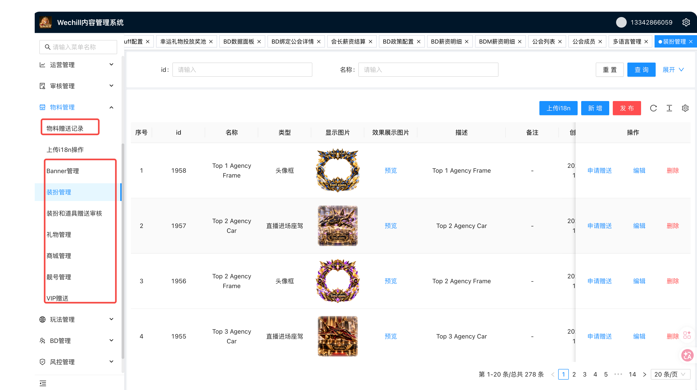

该图仅圈选物料导航并露出装扮列表，不代表每个菜单都有独立详情原型。靓号、装扮、商城、VIP分别按5.10—5.12、5.37处理，礼物存量见6.1。

##### 前置条件

具备原入口及操作权限，所选区在角色可管理范围内；首次无记忆或原区失权时从顶部选择器重新选区，不自动代选。后续查询、提交和审核均核对最新权限，失权区旧结果不能继续操作。

##### 触发方式

进入物料总览及原已有菜单。

##### 字段与数据来源

本页不新增字段；圈选菜单仅作范围证据，具体字段以已有功能或对应独立原型为准。

##### 交互逻辑

只承接本轮菜单范围：装扮本体共享的明确旁白来自独立装扮页，不能把共享例外扩到靓号、礼物和商城。礼物保留“包含土区的礼物复制一份归TR、原有礼物归MENA”的既定处理，各区礼物ID分开维护；其他区、旧引用及未完成送礼不增加额外处理。不从导航新增表单或发布流程。

##### 服务端核心逻辑

查询、定位及执行共同遵守3.3，不只过滤列表；不信任自报大区，不改原业务资格、金额及保存身份。非单用户／共享配置按本节明确范围处理，不强行套用某个用户的大区。

##### 状态设计

沿原业务状态，不新增状态流；本区／切区情形统一见3.3，模块特有边界见下文。菜单总览不补造独立业务状态。

##### 边界条件

没有独立正文的菜单只登记范围与配图；具体未给出的字段／执行状态不补造。

##### 异常处理

原业务失败沿原流程；分区异常使用3.3已确认的共用提示，不返回其他区账号信息。未定义的默认、补偿或重试不自行补造。

##### 权限控制

角色可管理范围、顶部所选区及原入口／操作权共同生效；切区不产生新权限，也不迁移原对象归属。

### 5.39 玩法管理总览范围

#### 模块背景

将当前指定页面接入共用分区边界；只描述分区变化或原型范围，不复述原业务全字段。

#### 用户场景

操作人在有权限的所选大区进入本页，按原业务范围查询或处理。

#### 对应原型

当前Axure指定目录“玩法管理”；完整画布如下，缺少分区控件的现状截图仍按本文已确认共用要求处理。

#### 功能点：玩法管理总览范围分区范围

##### 功能说明

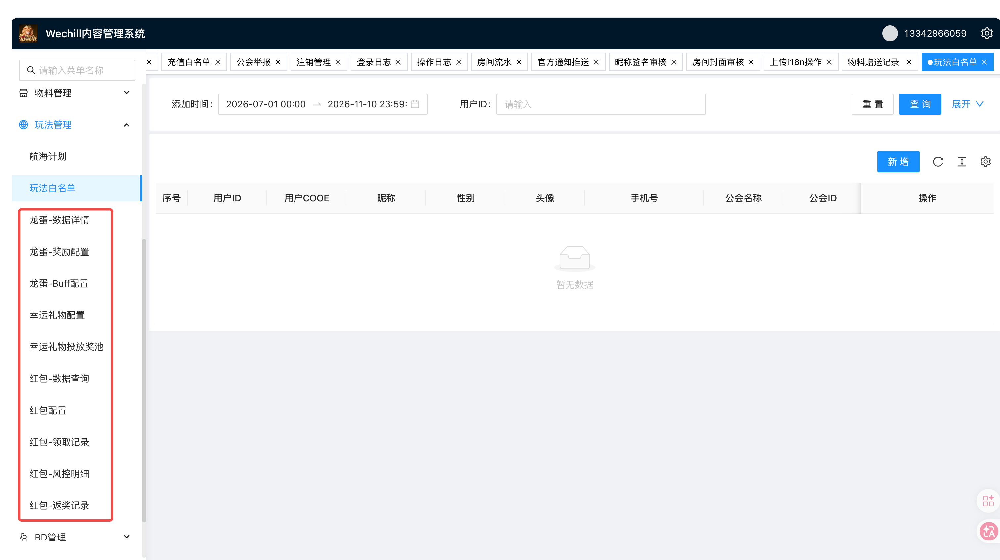

该图圈选龙蛋、幸运礼物、红包相关导航；当前正文是玩法白名单现状，不是各玩法详情。红包、龙蛋沿用已有分区配置与日常功能，不重做配置，不新增概率或返奖规则。

##### 前置条件

具备原入口及操作权限，所选区在角色可管理范围内；首次无记忆或原区失权时从顶部选择器重新选区，不自动代选。后续查询、提交和审核均核对最新权限，失权区旧结果不能继续操作。

##### 触发方式

进入玩法总览及原已有菜单。

##### 字段与数据来源

本页不新增字段；圈选菜单仅作范围证据，具体字段以已有功能或对应独立原型为准。

##### 交互逻辑

菜单没有独立规则页时只登记范围。当前查询／操作按3.3；红包、龙蛋不安排额外停服、退款或进度清理。游戏／幸运礼物历史记录不补区，分区后记录按业务发起时服务端确认的对应用户大区区分，查询仍限定所选区。

##### 服务端核心逻辑

查询、定位及执行共同遵守3.3，不只过滤列表；不信任自报大区，不改原业务资格、金额及保存身份。非单用户／共享配置按本节明确范围处理，不强行套用某个用户的大区。

##### 状态设计

沿原业务状态，不新增状态流；本区／切区情形统一见3.3，模块特有边界见下文。菜单总览不补造独立业务状态。

##### 边界条件

游戏名单历史不补区、不直接作废，继续按5.9原规则检查有效性及黑白名单互斥；用户已在任一名单时不能再次加入任何名单，保留“该用户已在名单中，无法继续添加至名单”的固定提示。旧记录缺可信用户关联时先核实，不能绕过检查或扩大原影响范围。红包、龙蛋按现有日常流程运行；不从奖池、领取、风控等菜单名称推导算法或自动补偿。

##### 异常处理

原业务失败沿原流程；分区异常使用3.3已确认的共用提示，不返回其他区账号信息。未定义的默认、补偿或重试不自行补造。

##### 权限控制

角色可管理范围、顶部所选区及原入口／操作权共同生效；切区不产生新权限，也不迁移原对象归属。

### 5.40 风控管理总览范围

#### 模块背景

将当前指定页面接入共用分区边界；只描述分区变化或原型范围，不复述原业务全字段。

#### 用户场景

操作人在有权限的所选大区进入本页，按原业务范围查询或处理。

#### 对应原型

当前Axure指定目录“风控管理”；完整画布如下，缺少分区控件的现状截图仍按本文已确认共用要求处理。

#### 功能点：风控管理总览范围分区范围

##### 功能说明

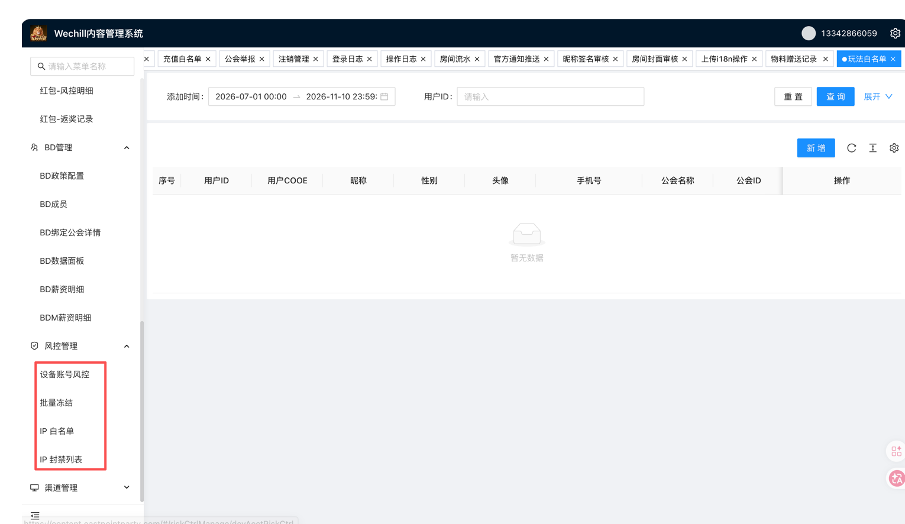

该图只圈选设备账号风控、批量冻结、IP白名单、IP封禁列表四个菜单，未打开其正文。仅登记本轮范围；当前消费者用户数据操作受3.3约束。

##### 前置条件

具备原入口及操作权限，所选区在角色可管理范围内；首次无记忆或原区失权时从顶部选择器重新选区，不自动代选。后续查询、提交和审核均核对最新权限，失权区旧结果不能继续操作。

##### 触发方式

进入原风控相关菜单。

##### 字段与数据来源

本页不新增字段；圈选菜单仅作范围证据，具体字段以已有功能或对应独立原型为准。

##### 交互逻辑

本版将分区后数据区分大区，历史记录不补区。设备／IP只展示当前区有权查看的关联数据，不按任意用户或登录人给共享对象归区；实际操作若会影响其他区，先按原权限核实影响范围，不能当作“仅操作本区”直接执行。不新增阈值、冻结或封禁机制。

##### 服务端核心逻辑

查询、定位及执行共同遵守3.3，不只过滤列表；不信任自报大区，不改原业务资格、金额及保存身份。非单用户／共享配置按本节明确范围处理，不强行套用某个用户的大区。

##### 状态设计

沿原业务状态，不新增状态流；本区／切区情形统一见3.3，模块特有边界见下文。菜单总览不补造独立业务状态。

##### 边界条件

分区后的单用户风控记录取业务发起时对应用户的可信大区，设备／IP关联按上述共享对象边界处理。历史能关联可信用户的仍只查所选区，无法关联的由有原处理权限的人员核实，不开放全区查询。具体详情原型未提供，批量冻结仍沿原流程，不将赠送／审核的批量策略外推到冻结，也不以当前玩法白名单正文冒充风控详情。

##### 异常处理

原业务失败沿原流程；分区异常使用3.3已确认的共用提示，不返回其他区账号信息。未定义的默认、补偿或重试不自行补造。

##### 权限控制

角色可管理范围、顶部所选区及原入口／操作权共同生效；切区不产生新权限，也不迁移原对象归属。

## 6. 附录

### 6.1 最新脑图的存量对象与处理口径

以下以当前脑图“存量数据切割”为基础，并以用户最新确认方案更新。**当前对象需要归区、历史记录不回填、分区后记录区分大区**是三件不同的事；不再采用旧稿将所有历史按用户当前区回填的方案。本节仅定义需求，不执行数据操作。

#### 当前资产、政策、功能和物料

| 对象 | 最新确定处理 | 保留的边界／依赖 |
| --- | --- | --- |
| 金币、水晶、钻石余额、当期钻石流水、可提现余额、未结算工资 | 无需处理；本次分区切割不对这些已有数值另做膨胀、缩放或清零 | 原业务正常增减、结算继续沿用；新政策适用时点见T12，不因改币价重算历史资产 |
| 公会政策 | 已分区，无需重新处理归区；与改币价同步更新政策配置 | 正式新政策表及生效时刻待负责人提供；已发生未结工资用原适用政策 |
| BD政策 | 分区前，先将政策分配到对应大区的BD用户；执行分区时，按当前政策绑定BD所在大区确定政策归属 | 多区共用先按当前有效BD分别分配；无绑定、离职或换绑导致归属不清先人工确认；归区后不因后续换绑自动迁移 |
| VIP | 天数、等级、权益不变，仅改变VIP售价 | 新售价配置沿1.0，不借分区重算旧权益 |
| 红包 | 已有分区配置，本次无需额外处理 | 配置及存量沿现有流程，不新增专项处理 |
| 龙蛋 | 已有分区配置，本次无需额外处理 | 配置及存量沿现有流程，不新增专项处理 |
| CP经验 | 用户确认该内容已处理，本版不再追加存量调整 | 不将此前未明确采纳的经验、等级、权益建议写成已定规则；新配置沿1.0 |
| 礼物 | 包含土区的礼物全部复制一份，复制份归土区；原有礼物全部归中东 | 各区礼物ID分开维护；T15所问其他区、旧引用及未完成送礼无需额外处理 |
| 商城 | 当前商城默认归中东；土区按新币价重新上架，各区使用各自商品ID管理 | 与5.12一致；已购权益及未完成旧订单保留原价格、原权益，不重复扣款；具体价格、时间、其他区清单及规格SKU细节见6.4 |
| 使用中的存量靓号 | 归正在使用该靓号的用户所在大区；脑图明确TR用户归TR、MENA用户归MENA，其他已确认使用关系沿用该主体口径 | 新号仍按创建时后台所选区；单个靓号对象不会多人同时使用，关系缺失先核实 |
| 无用户使用的存量靓号 | 沿此前用户确认，默认归中东 | 仅指核实确实无人使用的存量；收回或过期后保留靓号原所属区 |
| 榜单存量 | 无需处理 | 不新增榜单功能或页面 |

更新币价时同步更新对应配置，不为此额外处理用户资产。需调整配置与记录分区的生效时刻、月底结算前完成的具体账期由业务负责人提供；红包、龙蛋不新增额外处理。

#### 分区后记录的大区区分

**分区前历史数据不做处理；分区后的数据需要区分大区，纳入本版全量完成。** 下表主体沿用脑图及此前已确认口径，但不再用于给历史记录批量回填。生效时刻待负责人提供；新记录在业务发起时取下表对应主体的可信大区，不取后台操作人的大区。

| 数据类别 | 分区前历史 | 分区后记录归区主体／范围 |
| --- | --- | --- |
| 提现金币记录 | 不处理、不重算 | 发起提现金币的用户 |
| 充值明细 | 不处理、不重算 | 发起充值的用户 |
| 提现给公会长记录 | 不处理、不重算 | 发起提现的用户，不按收款公会长 |
| 提现财务审核 | 不处理、不重算 | 发起现金提现的用户 |
| 币商买卖明细 | 不处理、不重算 | 出售币商在该笔业务发起时的可信大区，不取购买方；同笔交易合计不重复计入 |
| 靓号发放记录 | 不处理、不重算 | 业务发起时发放目标用户的可信大区，不按后台操作人 |
| 物料申请记录 | 不处理、不重算 | 业务发起时申请物料目标用户的可信大区，不按申请操作人 |
| 审核数据 | 不处理、不重算 | 原业务发起时对应用户；房间内容取房主，公会头像取公会、BD公会取申请公会、公会举报取被举报公会，资产双主体取资产目标用户 |
| 风控数据 | 不处理、不重算 | 分区后数据区分大区；跨区共用设备等非单用户对象见T18 |
| 游戏、幸运礼物数据 | 不处理、不重算 | 分区后数据区分大区；当前后台查询按3.3，不要求回填历史 |

记录按区查询不改变原金额、收款人、交易对方或审核目标。审核执行继续用原保存的不可变用户身份；不能因号码变化而重新找另一个人。未结束旧业务保留原用户、金额、价格和适用政策，缺可信身份先核实；历史能关联可信用户的仍限本区，不能关联的由有原权限人员核实，不开放全区查询。

#### BD、公会数据

脑图单独明确：**历史数据不做处理，分区后的数据需要区分。** 不把BD／公会历史重新分配到当前区，不因后台切区更改原团队、公会关系或工资。当前BD／公会页面按所选区查询和操作，存量BD政策另按6.1当前对象口径处理；政策归区不等于重算历史工资。

### 6.2 政策及功能配置联动

| 配置域 | 最新确定方向 | 实施条件与保留范围 |
| --- | --- | --- |
| 公会结算政策 | 已有分区保留，与改币价同步更新配置 | 负责人提供正式政策表及生效时刻；已发生未结工资沿原政策，新增业务按生效时点用新政策 |
| BD政策 | 先分配到对应区BD，分区时按绑定BD所在区归属；后台配置查询／操作按所选区 | 多区共用先分别分配，归属不清先人工确认，归区后不因后续换绑自动迁移；不另造薪资公式 |
| 红包／龙蛋 | 已有分区配置，配置及存量均无需额外处理 | 沿现有配置和日常流程，不新增专项处理 |
| CP、VIP | 分区配置沿1.0；VIP旧天数、等级、权益不变 | CP经验相关内容已处理，不追加本版调整；不扩写新客户端流程 |
| 礼物／商城 | 礼物TR复制、原有归MENA；商城当前归MENA、TR按新币价上架 | 礼物其他区／旧引用／未完成送礼无额外处理；商城旧权益和旧订单保留原价格、原权益，运营补正式清单及切换时间 |

#### 配置、存量与后续记录的处理关系

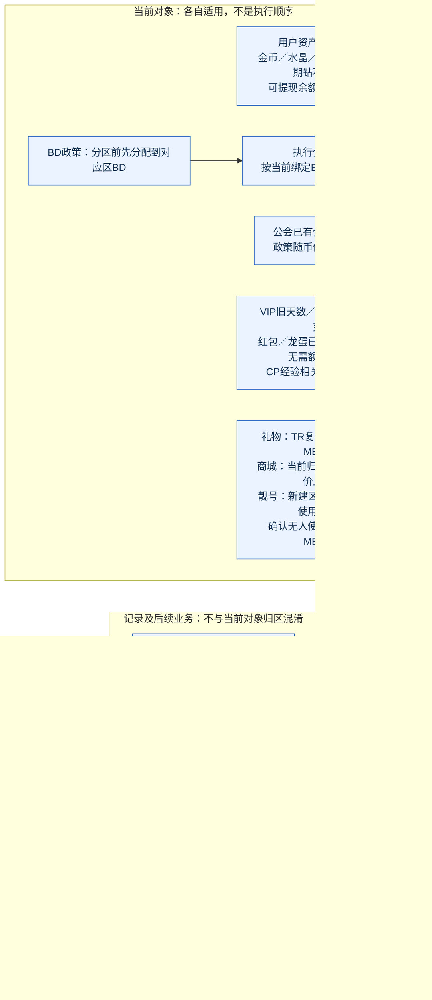

[查看最新存量处理关系图](./核对记录/流程图/flow-04.svg)

图中卡片为并列分类，只有BD政策两节点的箭头表示业务先后；记录分区和权限约束不是存量操作的末尾步骤。BD“先分配、再按绑定BD归区”为脑图明确顺序；配置生效及原在途业务使用新旧政策的方式见3.5；具体生效时刻及正式政策表待负责人提供，不定义自动迁移、自动补偿或回滚平台。

### 6.3 本版范围边界

| 范围 | 本轮处理 |
| --- | --- |
| 当前指定后台文件夹40页 | 逐页读取原型、旁白及交互；页面增量、仅菜单范围和1.0沿用分别标记在6.6，不以侧栏菜单露出冒充独立详情页 |
| 其他Axure文件夹 | 不纳入本轮增改；不从“无需处理的模块”恢复渠道、航海计划等旧范围 |
| 1.0已覆盖功能 | 计算、套餐、兑换及VIP赠送原规则沿用；当前VIP页仅承接本轮角色与选区边界，不重写已覆盖字段 |
| 4.1三方充值模块 | 保留既有主流程，仅补T21／T22已确认的选择、关闭和失败处理；原型未改，不扩大到其他客户端功能 |
| 最新脑图的存量要求 | 按6.1及用户最新确认更新；红包／龙蛋无需额外处理，CP经验已处理，礼物复制归区保留；不恢复历史回填 |
| 充值活动 | 不纳入本文后台分区改造范围；不采纳仅改换算比例的备选方案 |
| 灵仙游／自研游戏／zeeone额外分区接入 | 本轮不新增接入或独立服务器范围，未覆盖能力仍沿1.0边界 |
| 用户归属纠正及跨区迁移 | 不支持切区，互斥草案不转为正式功能；IP／地理误分见T01 |
| 分区后记录 | 本版完成按6.1对应主体区分大区；历史不处理，不恢复历史补区要求 |
| 脑图中其他范围外内容 | 仅做覆盖核对，不扩写客户端、榜单或曝光功能 |

### 6.4 已确认方案与执行前待补充信息

本表以用户填写的“确认方案”及本轮对话澄清为准，已同步到对应章节；原建议不再作为另一套规则保留。“按建议处理”只确认处理方式，不代表实际价格、日期、政策表或商品清单已提供。部分问题尚未回答的，仅保留下列具体缺口，不重复追问已确定事项。

| 编号 | 已确认处理方式 | 正文落点 | 仍需提供或确认 | 状态 |
| --- | --- | --- | --- | --- |
| T01 | 全部大区启用；历史空值归EN，大区值不合法默认归中东。 | 3.2、5.25 | 资料冲突、IP／地理误分如何核实纠正；统一大区列表怎样更新，原确认未给具体处理。 | 部分确认 |
| T02 | 用户ID／CODE沿原关系；不存在原始号与靓号重复占用；不同区可同靓号。恢复原号遇占用先解决冲突，不覆盖他人号码。 | 3.3、3.6、5.10 | 无 | 已落实 |
| T03 | 多角色范围取并集，操作权限与获配区不能跨角色拼接；已有角色由管理员分配。首次／失权本人重选；下次查询、提交、审核按最新权限。多端各保留工作区，记最后成功保存；保存失败保留原区，切区前确认放弃未提交内容。角色筛选按包含该区匹配。 | 3.3、3.6、5.1、5.16 | 无 | 已落实 |
| T04 | 先整批检查；混区、查无、身份不唯一或重复目标时整批不执行并列问题项。通过后逐条结果，重试只处理失败项。 | 3.3、5.3、5.15、5.30、5.35 | 无 | 已落实 |
| T05 | 目前会长、公会、主播、BD／BDM不存在不同区；不据此新增跨区功能或全局禁止。 | 3.3、5.2、5.8、5.19—5.22、5.32—5.35 | 邀请人与政策、币商与公会、资产接收方与扣薪方若不同区，各入口能否操作；若已有跨区贡献如何处理，仍未明确。 | 部分确认 |
| T06 | 红包已有分区配置，本次配置及存量均无需额外处理。 | 3.4、5.39、6.1、6.2 | 无 | 按最新确认取消额外处理 |
| T07 | 龙蛋已有分区配置，本次配置及存量均无需额外处理。 | 3.4、5.39、6.1、6.2 | 无 | 按最新确认取消额外处理 |
| T08 | 单个靓号对象不存在多人同时使用；缺使用关系先核实，确认无人使用的存量才归中东。收回／到期保留靓号原所属区。 | 3.6、5.10、6.1 | 无 | 已落实 |
| T11 | 现有商城归中东；土区按运营正式新价格清单、明确窗口重新上架，各区商品ID独立。已购权益、未完成旧订单保留原价格与权益，不重复扣款；其他区先核实商品及归属。 | 5.12、6.1、6.2 | 土区正式商品／价格清单和上架时间；其他区商品及归属清单；如有不同规格／天数独立SKU，其新建范围及新旧映射尚未明确。 | 处理方式已定，实际清单待补 |
| T12 | 沿现有财务时区，由负责人明确切换时刻和结算账期。新政策取正式批准表，已发生未结工资用原政策，新增业务按生效时点用新政策。BD多区共用先分别分配，归属不清先人工确认，归区后不因换绑自动迁移。各配置分别写明适用条件；红包、龙蛋按T06／T07无需额外处理。 | 3.5、5.13、5.18、6.1、6.2 | 切换日期和全部启用区对应时间、结算账期、正式政策表及各需调整配置的生效时间。 | 处理方式已定，实际值待补 |
| T13 | 用户确认CP经验相关内容已处理，本版不再追加存量调整。 | 3.4、6.1、6.2 | 未将此前经验倍率／等级／权益建议当作已采纳规则，不新增待办。 | 已处理 |
| T14 | 新记录取业务发起时对应主体的可信大区；币商买卖按出售币商归区。旧在途保留原身份、金额、价格及政策，缺可信身份先核实；历史不补区，不通过全区查询解决旧记录关联缺失。 | 3.3、5.11、5.13、5.29、6.1 | 无 | 已落实 |
| T15 | 保留土区礼物复制一份、原礼物归中东；其他区、旧引用及未完成送礼无需额外处理。 | 6.1、6.2 | 无 | 按表内回答及对话澄清落实 |
| T16 | 当日统计仍统计当天，明细时间筛选只影响明细；沿现有财务时区。财务牵头按大区、原账期和对应APPID核对；差异查原因、重复不重记、延迟到账后核对，不估算补账。 | 5.13 | 无；具体切换账期与T12共用，不另编日期。 | 已落实 |
| T17 | 历史名单不补区、不直接作废；沿原有效性和黑白互斥规则，任一名单已存在即不能再添加；缺可信关联先核实，不扩大查询或影响范围。 | 5.9 | 无 | 已落实 |
| T18 | 已确认共用配置继续共用；BD全局模板与分区政策分开，后台账号／菜单沿原权限，业务日志按对象、系统日志沿原权限。设备／IP只展示本区有权关联，影响其他区先核实权限；房间按房主；局部筛选不扩大顶部范围。 | 3.4、5.14、5.15、5.18、5.23、5.24、5.27、5.28 | 其他共享配置的具体项目仍需逐项确认，不擅定全部共享或全部拆区。 | 处理方式已定，其他配置清单待补 |
| T19 | 后台分区校验提示已固定，且不返回其他区账号信息；游戏名单原固定提示不变。 | 3.3及各后台异常处理 | 无 | 已落实 |
| T21 | 候选按大区、用户ID固定排序，不默认选中，未选时确认按钮不可用；取消／关闭不发码、返回原输入，候选多时原弹窗内滚动。 | 4.1 | 同资料账号额外区分不纳入本次，不增加大区／用户ID展示字段。 | 按明确采纳范围落实 |
| T22 | 同次输入不会同时命中用户ID和靓号。候选查询失败提示并允许重试；确认时账号失效保留输入、清除选择、重新查询，不给失效账号发码。 | 4.1 | 无 | 已落实 |
| T23 | 新BD归属取可信用户资料，顶部区仅核对资格；无法确定归属先不创建。直接上级只加载本区原资格候选，不依赖隐藏大区字段。两个公会页面局部区筛选不能扩大顶部范围。 | 5.17、5.22、5.31 | 无 | 已落实 |
| T24 | 公会头像按公会区、BD公会审核按申请公会区、公会举报按被举报公会区；资产双主体按资产目标用户定范围，另查扣薪方归属与资格，不用一方权限代替另一方。 | 3.4、5.30、5.31、5.34、5.35 | 双主体异区的具体操作资格仍见T05，不重新待定已明确的记录主体。 | 主体已定，跨区资格保留T05 |

### 6.5 最新脑图模块覆盖索引

| 当前主图模块 | 本稿去向 | 本轮处理 |
| --- | --- | --- |
| 货币体系 | 1.2、6.1 | 新交易／配置沿1.0，用户存量资产无需处理 |
| 物料→靓号 | 3.2、3.6、5.10、6.1 | 创建区、使用者归区、无人使用存量归中东与本区定位分开 |
| 物料→礼物／商城 | 5.12、6.1、T11／T15 | 采用最新存量明确方向；旧标签不覆盖本次存量要求 |
| 后台系统→权限／查询／操作 | 3.2—3.6、5.1、5.16及本轮后台模块 | 角色授权→候选区→所选区→本区查询及执行 |
| 财务／游戏 | 5.7—5.9、5.13—5.14、6.1 | 后台范围和历史／未来记录分开；厂商能力沿1.0 |
| 功能／公会结算政策 | 1.2、6.1—6.2 | VIP／CP新配置沿1.0；存量及政策按6.1—6.2与用户最新确认，脑图用于覆盖溯源 |
| 数据跨区处理 | 3.2、6.3、T01 | 不支持用户切区，不采纳清资产等迁移草案 |
| 存量数据切割 | 3.4、6.1—6.4 | 当前对象、分区后记录及BD／公会历史规则均在本版落实 |
| 活动、榜单、曝光及自由主题 | 6.1、6.3／配套核对记录 | 不新增范围外功能；仅保留最新存量无需处理口径及明确的范围边界 |

当前脑图为1张画布、152个主题，逐主题原文和处理去向见[源材料覆盖与自检](./核对记录/源材料覆盖与自检.md)。主题总数不是本期功能数，也不沿用初版189主题／3画布的统计。

### 6.6 当前指定后台文件夹逐页去向

本表仅列本次“需要进行分区处理的后台模块”的40页。原型就近插入对应模块；只有菜单圈选的画布仅确定其指向范围，不据此补造详情字段。后台原型范围仅限这40页；4.1原型和其他文件夹未改，4.1正文仅同步T21／T22已确认交互，不扩大到其他客户端功能。

| 序号 | 当前Axure路径 | 正文位置 | 处理 |
| --- | --- | --- | --- |
| 1 | /需要进行分区处理的后台模块/系统设置 | 5.16 | 当前页分区增量／核心关系 |
| 2 | /需要进行分区处理的后台模块/选择大区 | 5.1 | 当前页分区增量／核心关系 |
| 3 | /需要进行分区处理的后台模块/BD管理/BD成员 | 5.17 | 当前页分区增量／核心关系 |
| 4 | /需要进行分区处理的后台模块/BD管理/BD政策配置 | 5.18 | 当前页分区增量／核心关系 |
| 5 | /需要进行分区处理的后台模块/BD管理/BD数据面板 | 5.19 | 当前页分区增量／核心关系 |
| 6 | /需要进行分区处理的后台模块/BD管理/BD薪资明细 | 5.20 | 当前页分区增量／核心关系 |
| 7 | /需要进行分区处理的后台模块/BD管理/BDM薪资明细 | 5.21 | 当前页分区增量／核心关系 |
| 8 | /需要进行分区处理的后台模块/BD管理/BD绑定公会详情 | 5.22 | 当前页分区增量／核心关系 |
| 9 | /需要进行分区处理的后台模块/BD管理/系统管理 | 5.23 | 菜单／总览范围，不补造未给详情 |
| 10 | /需要进行分区处理的后台模块/房间管理/房间列表 | 5.24 | 当前页分区增量／核心关系 |
| 11 | /需要进行分区处理的后台模块/用户列表/用户列表 | 5.25 | 当前页分区增量／核心关系 |
| 12 | /需要进行分区处理的后台模块/用户列表/充值白名单 | 5.26 | 当前页分区增量／核心关系 |
| 13 | /需要进行分区处理的后台模块/用户列表/封号封设备 | 5.27 | 当前页分区增量／核心关系 |
| 14 | /需要进行分区处理的后台模块/用户列表/设备白名单 | 5.28 | 当前页分区增量／核心关系 |
| 15 | /需要进行分区处理的后台模块/用户列表/注销管理 | 5.29 | 当前页分区增量／核心关系 |
| 16 | /需要进行分区处理的后台模块/公会管理/公会列表 | 5.2 | 当前页分区增量／核心关系 |
| 17 | /需要进行分区处理的后台模块/公会管理/公会头像审核 | 5.30 | 当前页分区增量／核心关系 |
| 18 | /需要进行分区处理的后台模块/公会管理/BD公会审核 | 5.31 | 当前页分区增量／核心关系 |
| 19 | /需要进行分区处理的后台模块/公会管理/主播薪资结算 | 5.32 | 当前页分区增量／核心关系 |
| 20 | /需要进行分区处理的后台模块/公会管理/会长薪资结算 | 5.33 | 当前页分区增量／核心关系 |
| 21 | /需要进行分区处理的后台模块/公会管理/公会举报 | 5.34 | 当前页分区增量／核心关系 |
| 22 | /需要进行分区处理的后台模块/平台管理/资产赠送 | 5.3 | 当前页分区增量／核心关系 |
| 23 | /需要进行分区处理的后台模块/平台管理/资产扣除 | 5.4 | 当前页分区增量／核心关系 |
| 24 | /需要进行分区处理的后台模块/平台管理/币商金币操作 | 5.5 | 当前页分区增量／核心关系 |
| 25 | /需要进行分区处理的后台模块/平台管理/财富魅力等级 | 5.6 | 当前页分区增量／核心关系 |
| 26 | /需要进行分区处理的后台模块/平台管理/游戏币管理 | 5.7 | 当前页分区增量／核心关系 |
| 27 | /需要进行分区处理的后台模块/平台管理/资产操作审核 | 5.35 | 当前页分区增量／核心关系 |
| 28 | /需要进行分区处理的后台模块/平台管理/等级操作审核 | 5.36 | 当前页分区增量／核心关系 |
| 29 | /需要进行分区处理的后台模块/运营管理/币商管理 | 5.8 | 当前页分区增量／核心关系 |
| 30 | /需要进行分区处理的后台模块/运营管理/游戏黑名单 | 5.9 | 当前页分区增量／核心关系 |
| 31 | /需要进行分区处理的后台模块/物料管理/靓号管理 | 5.10 | 当前页分区增量／核心关系 |
| 32 | /需要进行分区处理的后台模块/物料管理/装扮管理 | 5.11 | 当前页分区增量／核心关系 |
| 33 | /需要进行分区处理的后台模块/物料管理/商城管理 | 5.12 | 当前页分区增量／核心关系 |
| 34 | /需要进行分区处理的后台模块/物料管理/VIP赠送 | 5.37 | 1.0沿用，仅承接本轮范围 |
| 35 | /需要进行分区处理的后台模块/财务管理/财务管理 | 5.13 | 当前页分区增量／核心关系 |
| 36 | /需要进行分区处理的后台模块/运营管理 | 5.14 | 当前页分区增量／核心关系 |
| 37 | /需要进行分区处理的后台模块/审核管理 | 5.15 | 当前页分区增量／核心关系 |
| 38 | /需要进行分区处理的后台模块/物料管理 | 5.38 | 菜单／总览范围，不补造未给详情 |
| 39 | /需要进行分区处理的后台模块/玩法管理 | 5.39 | 菜单／总览范围，不补造未给详情 |
| 40 | /需要进行分区处理的后台模块/风控管理 | 5.40 | 菜单／总览范围，不补造未给详情 |

上述40页已在本版后台范围刷新时逐页读取页面、画布旁白、Note、交互及截图；本轮根据已保存材料和人工确认调整正文，不再次抓取原型。Note／交互为空不代表画布没有说明。未修改Axure、原脑图、1.0或业务代码，未登录业务后台执行任何新增、赠扣、审批、保存或删除。
